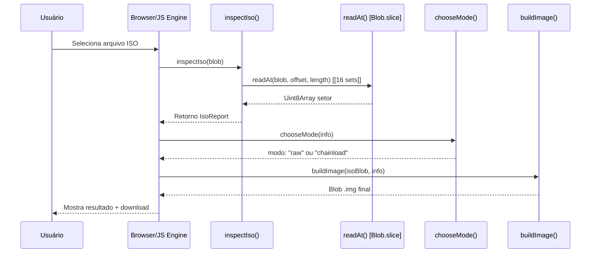

# Arquitetura e Diagramas UML - bootable-studio

## 1. Visão Geral da Arquitetura

O bootable-studio segue uma arquitetura client-side (browser-first) com três módulos principais:

```
graph TD
    A[Usuário: Input File ISO] --> B[inspectIso(blob)]
    B --> C{chooseMode(info)}
    C -->|mode: raw| D[buildImage(raw)]
    C -->|mode: chainload| E[buildImage(chainload)]
    D --> F[Blob .img -dd]
    E --> G[Blob .img -chainload]
    F --> H[Usuário faz download]
    G --> H
    
    style A fill:#e1f5fe,stroke:#01579b
    style B fill:#fff3e0,stroke:#ef6c00
    style C fill:#e8f5e9,stroke:#2e7d32
    style D fill:#f3e5f5,stroke:#6a1b9a
    style E fill:#f3e5f5,stroke:#6a1b9a
    style F fill:#fffde7,stroke:#fbc02d
    style G fill:#fffde7,stroke:#fbc02d
    style H fill:#eceff1,stroke:#78909c
```

## 2. Diagrama de Casos de Uso

```mermaid
useCaseDiagram
  actor User
  package "bootable-studio" {
    usecase "Upload ISO" <<upload>> \
    usecase "Inspecionar ISO" <<inspect>> \
    usecase "Escolher Modo de Build" <<chooseMode>> \
    usecase "Gerar Imagem .img" <<build>> \
    usecase "Download Imagem" >>download>> \
    usecase "Ver Warnings/Relatório" >>report>>

    User --> "Upload ISO"
    User --> "Inspecionar ISO"
    User --> "Escolher Modo de Build"
    User --> "Gerar Imagem .img"
    User --> "Download Imagem"
    User --> "Ver Warnings/Relatório"
  }
```

## 3. Diagrama de Classes / ER

```mermaid
classDiagram
  class IsoBlob {
    +blob: Blob
    +name: string
    +size: number
  }
  class IsoParser {
    +inspectIso(blob: Blob): IsoReport
    -le16(b, o): uint16
    -be16(b, o): uint16
    -le32(b, o): uint32
    -be32(b, o): uint32
    -ascii(b, o, len): string
    -PLATFORMS: map
    -MEDIA_TYPES: map
  }
  class BootEntry {
    +bootable: boolean
    +mediaType: number
    +mediaName: string
    +emulated: boolean
    +loadSegment: number
    +sectorCount: number
    +loadRba: number
    +sizeBytes: number|null
    +platform: string
    +isEfi: boolean
    +description: string
    +bootInfo: BootInfo|null
  }
  class BootInfo {
    +fileLba: number
    +length: number
    +checksum: number
    +matches: boolean
  }
  class IsoReport {
    +file: {name, size}
    +iso: PVD
    +totalSectors2048: number
    +mbr: MBRInfo
    +gpt: GPTInfo
    +elTorito: BootCatalog
    +boot: BootModeInfo
    +warnings: string[]
  }
  class MBRInfo {
    +signature: boolean
    +isohybrid: boolean
    +partitions: Partition[]
    +bootCodeBytes: number
    +protectiveMBR: boolean
  }
  class Partition {
    +index: number
    +active: boolean
    +type: number
    +typeName: string
    +startLba: number
    +sectors: number
    +plausible: boolean
  }
  class GPTInfo {
    +present: boolean
    +hasEsp: boolean
    +entries: number
  }
  class BootModeInfo {
    +biosCd: boolean
    +biosUsb: boolean
    +uefiCd: boolean
    +uefiUsb: boolean
    +chainloadEntry: BootEntry|null
    +recommendedMode: string
  }
  class BuildError {
    +message: string
    +code: string
  }
  class IsoError {
    +message: string
    +code: string
  }

  IsoParser --> IsoReport : retorna
  IsoParser --> BootEntry : extrai
  IsoParser --> MBRInfo : extrai
  IsoParser --> GPTInfo : extrai
  IsoReport --> BootModeInfo : contém
  BootEntry --> BootInfo : pode ter
```

## 4. Diagrama de Sequência - Fluxo Principal (Inspeção)



## 5. Diagramas de Decisão (ADRs - Architecture Decision Records)

### ADR-001: Processamento Browser-First (No Cliente)
**Status:** Accepted  
**Contexto:** O projeto precisa garantir que arquivos ISO nunca saiam do computador do usuário (requisito LGPD/privacidade).  
**Decisão:** Todo o processamento (inspeção, parsing, build) acontece no navegador via JavaScript puro e Blob API. Nenhum upload para servidores externos.  
**Consequências:** 
- ✅ Conformidade com LGPD e privacidade
- ✅ Zero custo de servidor para processamento
- ✅ Latência dependente apenas do cliente do usuário
- ✅ Limite de tamanho imposto pelo Blob do navegador (~2GB safe limit)

### ADR-002: Uso de Blob.slice em vez de carregar arquivo inteiro
**Status:** Accepted  
**Contexto:** ISOs podem ter 5GB+ e navegadores não conseguem manter arquivos tão grandes na memória simultaneamente.  
**Decisão:** Usar a função `readAt()` que lê apenas os setores necessários via `Blob.slice()`, mantendo o uso de memória O(setor_size) em vez de O(iso_size).  
**Consequências:**
- ✅ Pode analisar ISOs de 10GB+ sem travar o navegador
- ✅ Performance melhorada (apenas ~64 setores lidos para ISO típica)
- ⚠️ Código mais complexo (offset-based reading)
- ⚠️ Necessário controle cuidadoso de bounds checking

### ADR-003: Emulador v86 WASM para testes de boot
**Status:** Accepted  
**Contexto:** Necessidade de validar que a imagem gerada realmente funciona em um ambiente de boot real, não apenas estruturalmente.  
**Decisão:** Usar o emulador v86 compilado para WebAssembly (arquivo v86.wasm + seabios.bin) integrado nos testes. O boot bem-sucedido é detectado pela saída "OK" na serial virtual.  
**Consequências:**
- ✅ Testes de integração reais (não mocks)
- ✅ Validação de que chainload/MBR funciona corretamente
- ✅ Dependência externa (v86.wasm ~200KB + bios files)
- ⚠️ Tempo de carregamento WASM adiciona ~2-10s inicial
- ⚠️ Necessita de configuração de listener de serial output

### ADR-004: Modo chainload limitado a entradas "no emulation" (mediaType 0)
**Status:** Accepted  
**Contexto:** A especificação El Torito define tipos de mídia diferentes e o chainload só funciona compativelmente com certos tipos.  
**Decisão:** O modo chainload só gera MBR funcional para entradas El Torito com mediaType 0 (what was originally floppy disk emulation, agora tratado como "no emulation" HD type). Entradas com mediaType 1-3 (floppy sizes) ou outros tipos recebem warning e não geram chainload funcional.  
**Consequências:**
- ✅ Comportamento previsível e documentado
- ✅ Warning claro ao usuário sobre limitação
- ⚠️ ISOs com apenas entradas emuladas precisam de tool externo (Rufus/Etcher)
- ⚠️ Pode frustrar usuários que esperam chainload para qualquer ISO

## 6. Matriz de Rastreabilidade RF x RN x UML

| RF | RN | Classes UML | Diagramas |
|----|----|------------|-----------|
| RF-001 | RN-001 | IsoParser, BootEntry | classDiagram |
| RF-002 | RN-001 | IsoParser, MBRInfo | classDiagram |
| RF-003 | RN-001 | IsoParser, BootCatalog | classDiagram |
| RF-004 | RN-001 | IsoParser, Partition | classDiagram |
| RF-005 | RN-004 | IsoParser, GPTInfo | classDiagram |
| RF-006 | RN-002, RN-003 | chooseMode() logic | sequenceDiagram |
| RF-007 | RN-003 | buildImage() | sequenceDiagram |
| RF-008 | RN-005 | IsoReport, warnings | classDiagram |
| RF-009 | - | boot.test.mjs integration | sequenceDiagram |
| RF-010 | - | Input file HTML | useCaseDiagram |

---
*Documento de Arquitetura e UML gerado na Fase 4*