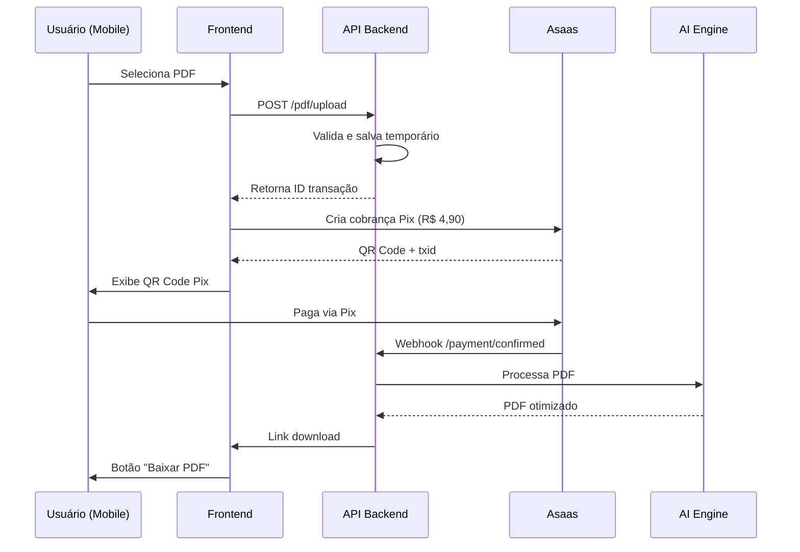
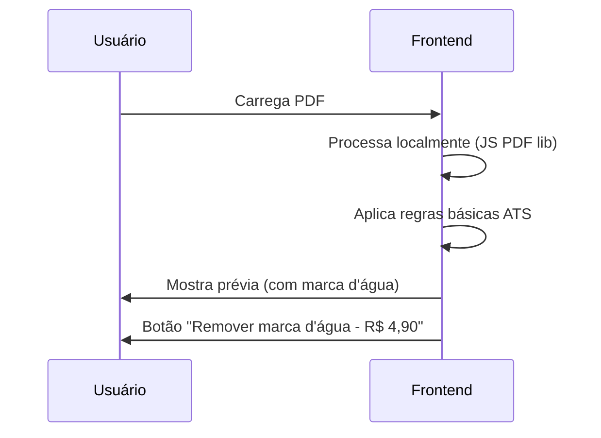

# Arquitetura do Sistema - Rezi App Brasil (PDF Sem Login)

---

## 1. Visão Geral da Arquitetura

```
┌─────────────────────────────────────────────────────────────────────────┐
│                           CLIENTS (Smartphones)                         │
│  ┌─────────────┐  ┌──────────────┐  ┌──────────────┐                     │
│  │  Android    │  │    iOS       │  │  Web (BETA)  │                     │
│  └─────────────┘  └──────────────┘  └──────────────┘                     │
└─────────┬──────────────────┬──────────────────┬─────────────────────────┘
          │                  │                  │
          │ Expo/Mobile SDK  │                  │
          ▼                  ▼                  ▼
┌─────────────────────────────────────────────────────────────────────────┐
│                       FRONTEND MOBILE (React Native)                      │
│  ┌─────────────┐  ┌──────────────┐  ┌──────────────┐                     │
│  │  Camera     │  │ File Picker  │  │  Share API   │                     │
│  └─────────────┘  └──────────────┘  └──────────────┘                     │
└──────────────────────────────────────────────────────────────────────────┘
          │                          │
          │ Local Processing         │ API Calls (HTTPS)
          ▼                          ▼
┌─────────────────────────────────────────────────────────────────────────┐
│                        BACKEND API (Node.js)                            │
│  ┌──────────────┐  ┌──────────────┐  ┌──────────────┐                  │
│  │   Auth (JWT) │  │  PDF Parser  │  │   AI Engine  │                  │
│  └──────────────┘  └──────────────┘  └──────────────┘                  │
│                                                                         │
│  ┌───────────────────────────────────────────────────────────────────┐  │
│  │                      PAYMENT SERVICE                              │  │
│  │  ┌─────────────┐  ┌──────────────┐  ┌──────────────┐               │  │
│  │  │ Asaas SDK   │  │ Stripe API   │  │ Webhook DB   │               │  │
│  │  └─────────────┘  └──────────────┘  └──────────────┘               │  │
│  └───────────────────────────────────────────────────────────────────┘  │
└─────────────────────────────────────────────────────────────────────────┘
          │
          ▼
┌─────────────────────────────────────────────────────────────────────────┐
│                      DEPENDENCY EXTERNALS                                │
│  ┌─────────────┐  ┌──────────────┐  ┌──────────────┐  ┌──────────────┐   │
│  │   AWS S3    │  │ Rezi ML API  │  │  Asaas API   │  │ Stripe API   │   │
│  │ (Temp Storage)│ │ (AI Model)   │  │ (Pix)        │  │ (Backup)     │   │
│  └─────────────┘  └──────────────┘  └──────────────┘  └──────────────┘   │
└─────────────────────────────────────────────────────────────────────────┘
```

---

## 2. Stack Tecnológica

### Frontend Mobile
| Tecnologia | Versão | Justificativa |
|------------|--------|---------------|
| **React Native** | 0.74+ | Desenvolvimento rápido, 1 base para iOS+Android |
| **Expo** | 49+ | Gerenciamento simplificado, sem native code |
| **Expo FileSystem** | - | Leitura de arquivos do dispositivo |
| **React Navigation** | - | Navegação entre telas |
| **Formik + Yup** | - | Validação de formulários |

### Backend API
| Tecnologia | Versão | Justificativa |
|------------|--------|---------------|
| **Node.js** | 18+ | JavaScript fullstack, vasta biblioteca |
| **Express.js** | - | Framework leve para API |
| **multer** | - | Upload de arquivos |
| **pdf-parse** | - | Extração de texto de PDF |
| **pdf-lib** | - | Manipulação PDF |
| **jsonwebtoken** | - | JWT para sessões (se necessário) |
| **axios** | - | Chamadas API externa |

### IA/Otimização
| Tecnologia | Versão | Justificativa |
|------------|--------|---------------|
| **Python 3.11** | - | Requisito para bibliotecas ML |
| **pdfplumber** | - | Extração precisa de texto PDF |
| **spaCy** | - | NLP para análise de palavras-chave |
| **Prologium** | - | Reze Engine para ATS |

### Infraestrutura
| Serviço | Região | Justificativa |
|---------|--------|---------------|
| **Vercel** | sa-east-1 | Deploy frontend React Native web |
| **AWS São Paulo** | sa-east-1 | Baixa latência Brasil |
| **Asaas** | - | Gateway Pix nacional |
| **Stripe Brasil** | - | Backup internacional |

---

## 3. Componentes do Sistema

### 3.1 Mobile Frontend
```
App/
├── assets/           # Ícones, imagens, fonts
├── components/       # Componentes UI reutilizáveis
│   ├── CameraPicker.tsx
│   ├── FileUploader.tsx
│   ├── PixQRCode.tsx
│   └── ShareButton.tsx
├── screens/          # Tela principal
│   ├── WelcomeScreen.tsx
│   ├── UploadScreen.tsx
│   ├── PaymentScreen.tsx
│   └── ResultScreen.tsx
├── services/         # APIs e integrações
│   ├── api.ts
│   ├── paymentService.ts
│   └── pdfService.ts
└── utils/            # Helpers
    ├── validation.ts
    └── formatting.ts
```

### 3.2 Backend API
```
api/
├── src/
│   ├── controllers/
│   │   ├── pdf.controller.ts
│   │   ├── payment.controller.ts
│   │   └── health.controller.ts
│   ├── routes/
│   │   ├── pdf.routes.ts
│   │   ├── payment.routes.ts
│   │   └── index.ts
│   ├── services/
│   │   ├── pdfService.ts
│   │   ├── aiService.ts
│   │   └── paymentService.ts
│   ├── middleware/
│   │   ├── upload.ts
│   │   └── errorHandler.ts
│   └── config/
│       └── database.ts
├── tests/            # Testes unitários
├── package.json
└── tsconfig.json
```

### 3.3 Microserviço de IA
```
ai-service/
├── main.py           # FastAPI server
├── services/
│   ├── pdf_analyzer.py
│   ├── keyword_optimizer.py
│   └── abrast_formatter.py
├── models/
│   └── ats_model.onnx  # Modelo otimizado
├── requirements.txt
└── entrypoint.sh
```

---

## 4. Fluxo de Dados

### 4.1 Fluxo Completo (PDF → Pix → Resultado)



### 4.2 Fluxo Offline (Sem pagamento)



---

## 5. Detalhamento das APIs

### 5.1 API de PDF

```http
POST /api/v1/pdf/upload
Content-Type: multipart/form-data
Authorization: Bearer <token temporário>

Form Data:
- file: PDF file (max 10MB)
- user_ip: string (para rate limit)

Response: 200 OK
{
  "transaction_id": "tx_abc123",
  "status": "uploaded",
  "filename": "curriculo.pdf"
}
```

```http
POST /api/v1/pdf/optimize/{transaction_id}
Authorization: Bearer <token temporário>

Response: 200 OK
{
  "optimization_id": "opt_123",
  "changes": [
    {"type": "keyword_added", "text": "Gestão de Projetos"},
    {"type": "format_fixed", "section": "Experiência"}
  ],
  "download_url": "https://cdn.app.com/optimized/abc123.pdf"
}
```

### 5.2 API de Pagamento

```http
POST /api/v1/payment/create
Content-Type: application/json

{
  "transaction_id": "tx_abc123",
  "amount": 4.90,
  "description": "Otimização completa de currículo"
}

Response: 200 OK
{
  "pix_qr_code": "base64_imagedata",
  "pix_key": "txid_123456",
  "expires_in": 900
}
```

---

## 6. Segurança

### 6.1 Headers de Segurança
```
Content-Security-Policy: default-src 'self'
X-Content-Type-Options: nosniff
X-Frame-Options: DENY
Strict-Transport-Security: max-age=31536000; includeSubDomains
```

### 6.2 Validações
- Tamanho arquivo ≤ 10MB
- Formato: PDF/A ou PDF padrão
- IP único: 1 otimização/24h para free
- Pix: ID único (UUID v4) + expiração 15 min

### 6.3 LGPD Compliance
- **Dados coletados**: Apenas IP e transaction_id (anônimo)
- **Armazenamento**: 30 dias após pagamento (ou download)
- **Direito de esquecimento**: Via endpoint DELETE /api/v1/data/{ip}
- **Política de privacidade**: Link na primeira tela

---

## 7. Escalabilidade

### 7.1 Horizontal Scaling
- **API Gateway**: Load balancer automático (AWS ALB)
- **Auto-scaling**: 1-10 instâncias conforme demanda
- **Database**: PostgreSQL RDS (opcional - para logs)

### 7.2 Cache
```
Redis (sa-east-1)
├── Session: JWT temporário (1h)
├── Rate limit: IP → count (24h)
└── PDF temp: ID → file path (30d)
```

### 7.3 CDN
```
Cloudflare (sa-east-1)
├── Arquivos PDF: cache 1h
└── Assets mobile: cache 30 dias
```

---

## 8. Monitoramento

### 8.1 Métricas Essenciais
- **Taxa de conversão**: Upload → Pagamento
- **Tempo médio de otimização**: < 10s
- **Taxa de erro Pix**: < 1%
- **Disponibilidade**: 99.5% uptime

### 8.2 Alerts
- API > 500 erros: alert Slack
- Pix não confirmado > 5 min: retry automático
- PDF processing > 30s: escalonamento

---

## 9. Plano de Deploy

### Fase 1 - MVP (4 semanas)
```
Mobile: Expo Go (test drive)
API: Localhost + ngrok
Pagamento: Sandbox Asaas
IA: Processamento básico (sem ML)
```

### Fase 2 - Produção (2 semanas)
```
Mobile: Build App Store + Google Play
API: Deploy Vercel/AWS
Pagamento: Produção Asaas + Stripe
IA: Deploy container Docker
```

### Fase 3 - Otimização (2 semanas)
```
Mobile: Offline mode
IA: Modelo ONNX otimizado
Cache: Redis implementado
Analytics: Google Analytics 4
```

---

## 10. Custos Operacionais Mensais

| Serviço | Plano | Custo Mensal |
|---------|-------|--------------|
| **AWS EC2** | t3.small (2 vCPU) | R$ 120 |
| **AWS S3** | 50GB storage | R$ 25 |
| **Asaas** | 2.9% + R$ 0,40/transação | Variável |
| **Stripe** | 6.28% + R$ 0,40 | Variável |
| **Cloudflare** | Pro (opcional) | R$ 0-50 |
| **TOTAL fixo** | - | **R$ 145-195** |

> Estimativa para 1.000 transações/mês: **R$ 185-235** (inclui taxas)