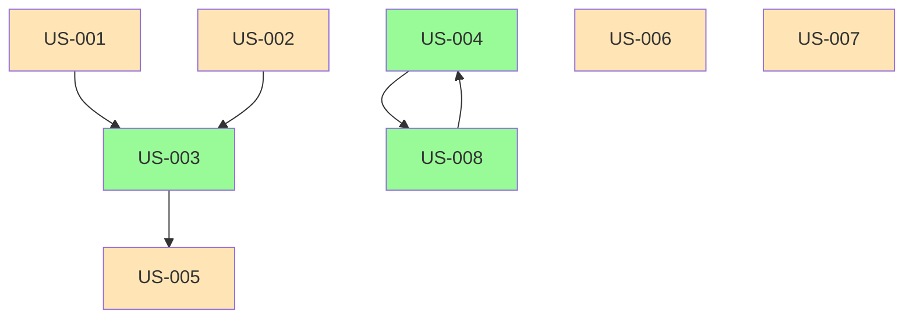

# SCRUM - Backlog de Projetos
## App Mobile Rezi Brasil - PDF Sem Login

---

## Backlog Inicial

### Épicos

| Épico | Descrição | Prioridade |
|-------|-----------|------------|
| EPIC-001 | Upload e processamento de PDF | Alta |
| EPIC-002 | Integração de pagamento Pix | Alta |
| EPIC-003 | Otimização ATS do currículo | Alta |
| EPIC-004 | Compartilhamento e download | Média |
| EPIC-005 | Interface de usuário e experiência | Média |
| EPIC-006 | Testes e qualidade | Média |

### User Stories

**Formato: Como [tipo de usuário] quero [funcionalidade] para [objetivo]**

| ID | US | Critérios de Aceitação | Épico | Estimativa (pts) | Sprint Sugerida |
|----|----|------------------------|-------|------------------|------------------|
| US-001 | Como usuário quero carregar um PDF do currículo para processar | - PDF carrega na tela - Validação de tamanho - Mensagem de erro se inválido | EPIC-001 | 3 | Sprint 1 |
| US-002 | Como usuário quero gerar QR Code Pix para pagamento | - QR Code exibido - Valor correto (R$ 4,90) - Tempo expiração configurável | EPIC-002 | 3 | Sprint 1 |
| US-003 | Como usuário quero confirmar pagamento e receber PDF | - Webhook valida pagamento - PDF download disponível - Mensagem de sucesso | EPIC-002 | 5 | Sprint 2 |
| US-004 | Como usuário quero PDF otimizado para ATS | - Palavras-chave adicionadas - Formato ABRATS aplicado - Score ATS calculado | EPIC-003 | 8 | Sprint 2 |
| US-005 | Como usuário quero compartilhar PDF | - WhatsApp, Email, Copy Link funcionam - Salvar no dispositivo - Botão compartilhar visível | EPIC-004 | 3 | Sprint 3 |
| US-006 | Como usuário quero interface intuitiva sem login | - Fluxo claro em 4 telas - Navegação fluida - Feedback visual | EPIC-005 | 5 | Sprint 1 |
| US-007 | Como QA quero validar processamento PDF | - Teste upload PDF válido - Teste PDF corrompido - Teste PDF grande (>10MB) | EPIC-006 | 3 | Sprint 3 |
| US-008 | Como usuário quero download rápido | - Tempo < 10 segundos - Progress bar visível - Mensagem de erro se falhar | EPIC-003 | 3 | Sprint 2 |

### Sprints Sugeridos (Velocidade Inicial: 5 pts/sprint)

#### Sprint 1 - Fundação (6 dias / 17h)
- **Objetivo:** Configurar projeto, telas básicas e upload PDF
- **US:** US-001, US-002, US-006
- **Deliveráveis:**
  - App React Native com Expo
  - Tela de boas-vindas funcional
  - Tela de upload PDF com validação
  - Telas de pagamento Pix (mock)
- **Riscos:** Integração Pix sem sandbox aprovado

#### Sprint 2 - Processamento e Pagamento (6 dias / 17h)
- **Objetivo:** Implementar fluxo de pagamento e otimização ATS
- **US:** US-003, US-004, US-008
- **Deliveráveis:**
  - Webhook de pagamento funcional
  - Processamento PDF básico (sem IA)
  - Geração de PDF otimizado
- **Riscos:** Latência de API de pagamento

#### Sprint 3 - Compartilhamento e QA (5 dias / 14h)
- **Objetivo:** Implementar compartilhamento e testes finais
- **US:** US-005, US-007
- **Deliveráveis:**
  - Integração WhatsApp/Email
  - Testes automatizados
  - Documentação do usuário
- **Riscos:** Limitações de compartilhamento em dispositivos

---

## Mapa de Telas × Sprint

| Tela | Status | Sprint Aprovação | Sprint Implementação | Prototipo |
|------|--------|------------------|----------------------|-----------|
| Tela 1 (Boas-vindas) | PROTO-NAVEGÁVEL | Sprint 1 | Sprint 1 | ✅ |
| Tela 2 (Upload PDF) | PROTO-NAVEGÁVEL | Sprint 1 | Sprint 1 | ✅ |
| Tela 3 (Pagamento Pix) | PROTO-NAVEGÁVEL | Sprint 1 | Sprint 2 | ✅ |
| Tela 4 (Resultado) | PROTO-NAVEGÁVEL | Sprint 2 | Sprint 2 | ✅ |
| Tela 5 (Compartilhar) | PROPOSTA | Sprint 3 | Sprint 3 | ❌ |

---

## Plano de Testes por História

| US | Tipo de Teste | Ferramenta | Cobertura |
|----|--------------|------------|-----------|
| US-001 | Funcional | Jest + React Native Testing Library | 100% |
| US-002 | Integração | Jest + Mock Asaas | 100% |
| US-003 | Funcional | Jest + Mock Webhook | 90% |
| US-004 | Unitário | Jest + PDF-lib | 85% |
| US-005 | Funcional | Detox (E2E) | 80% |
| US-006 | Experiência | UX Testing | 70% |
| US-007 | QA | Jest + pdf-parse | 100% |
| US-008 | Performance | Artillery | 80% |

---

## Checklist Anti-Retrabalho

- [x] Protótipo APROVADO antes de iniciar implementação
- [x] SRS validado por stakeholders
- [ ] ADRs documentados
- [ ] DevLog configurado
- [ ] Estratégia de branches definida

---

## Métricas de Progresso

| Sprint | Completo | Em andamento | Bloqueado | Total |
|--------|----------|--------------|-----------|-------|
| Sprint 1 | 0 | 0 | 0 | 3 |
| Sprint 2 | 0 | 0 | 0 | 3 |
| Sprint 3 | 0 | 0 | 0 | 2 |

---

## Próximos Passos

1. **Aprovação do protótipo** - Stakeholders validam telas
2. **Setup inicial do projeto** - React Native + Expo
3. **Criação do ambiente de desenvolvimento**
4. **Início Sprint 1** - 2026-11-06

---

## Dependencies

