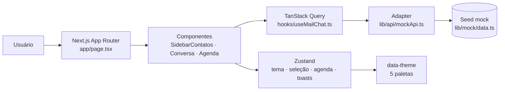

# SRS — MailChat

- **Versão:** 1.0
- **Data:** 2026-11-15
- **Status:** frontend concluído (escopo do protótipo aprovado)
- **Fontes:** `docs/proto/00-brief.md`, `docs/proto/10-roteiro-teste.md`, `docs/proto/20-mapa-implementacao.md`

## 1. Objetivo

Validar e entregar um cliente de e-mail com experiência de conversa: remetentes listados como
contatos, e-mails e respostas renderizados como bolhas de chat, artefatos (anexos) dentro da
conversa, paletas de cor variáveis e uma agenda com post-its que permitem anexar um e-mail a um
compromisso.

**Métrica de sucesso:** o usuário consegue (1) identificar o remetente, (2) ler a conversa e
localizar um artefato e (3) anexar o e-mail a um compromisso em menos de 60 segundos; taxa de
conclusão das 3 tarefas ≥ 80%.

## 2. Escopo

### 2.1 IN

- Tela única MailChat com lista de contatos, conversa e agenda.
- Dados mockados seguindo contratos de API pré-definidos.
- 5 paletas de cor, responsividade e acessibilidade.
- Testes unitários e E2E; lint, typecheck e build no CI.

### 2.2 OUT

Conforme brief §4:

- Autenticação real (IMAP/SMTP) e envio/recebimento real de e-mails.
- Persistência em backend/banco; múltiplas contas; notificações; push.
- Upload/arraste real de arquivos; integração Google/Outlook Calendar.

## 3. Persona e JTBD

- **Persona:** profissional ocupado que recebe dezenas de e-mails por dia com anexos e precisa
  decidir rápido entre responder, encaminhar ou agendar uma ação.
- **JTBD:** “Quando recebo um e-mail com anexos, quero vê-lo como uma conversa e decidir
  rapidamente se respondo agora ou marco uma ação na agenda.”

## 4. Requisitos funcionais

| ID | Requisito | Prioridade | Aceite |
|---|---|---|---|
| RF-01 | Listar contatos com avatar, nome, e-mail, assunto, não lidos, preview e horário; busca por nome/e-mail/assunto | Must | AC-01 |
| RF-02 | Abrir conversa e renderizar mensagens em bolhas (entrada/saída), ticks, horário e separador de data | Must | AC-01 |
| RF-03 | Renderizar artefatos (PDF, planilha, log) como cartões com nome e tamanho | Must | AC-01 |
| RF-04 | Responder por Enter ou botão; bloquear envio vazio com aviso; atualizar preview da lista | Must | AC-02 |
| RF-05 | Agenda com mini-calendário navegável, seleção de dia e lista ordenada por horário | Must | AC-03 |
| RF-06 | Criar post-it (título, data, horário, cor) vinculado a um e-mail; remover; chip volta à conversa | Must | AC-03 |
| RF-07 | Alternar entre 5 paletas (`whatsapp`, `oceano`, `violeta`, `rosa`, `noturno`) | Should | AC-04 |
| RF-08 | Configurações IMAP/SMTP simuladas com validação de campos | Should | AC-04 |
| RF-09 | Layout responsivo: ≤900px lista/chat em overlay; ≤1100px agenda em overlay | Must | AC-05 |
| RF-10 | Acessibilidade: `aria-label` em ícones, foco visível, `aria-live` nos toasts, `role="dialog"` e `prefers-reduced-motion` | Must | AC-05 |

## 5. Requisitos não funcionais

| ID | Requisito |
|---|---|
| RNF-01 | TypeScript `strict`; `tsc --noEmit` sem erros |
| RNF-02 | ESLint (flat config) sem erros/warnings |
| RNF-03 | Testes unitários (Vitest) e E2E (Playwright) verdes |
| RNF-04 | `npm audit` sem vulnerabilidades conhecidas |
| RNF-05 | Contraste AA nos pares principais; navegação por teclado; `focus-visible` |
| RNF-06 | Idioma pt-BR em toda a interface |
| RNF-07 | Build de produção estático (Next.js) |
| RNF-08 | CI escopado a `email-whatsapp/**`, sem afetar outros projetos do repositório |

## 6. Contratos de dados (adapter mock)

| Método | Rota | Entrada | Saída |
|---|---|---|---|
| GET | `/api/contatos` | — | `{ contatos: Contato[] }` |
| GET | `/api/contatos/:id/conversa` | `id` | `Contato` com `mensagens[]` |
| POST | `/api/conversas/:id/respostas` | `{ texto }` | `Contato` atualizado |
| POST | `/api/postits` | `{ titulo, data, horario, cor, emailId? }` | `AgendaPostIt` |
| DELETE | `/api/postits/:id` | `id` | `204` |
| GET | `/api/agenda?data=YYYY-MM-DD` | `data` | `AgendaPostIt[]` |
| GET | `/api/agenda?mes=YYYY-MM` | `mes` | `AgendaPostIt[]` |

Tipos em `frontend/lib/types.ts`; implementação mock em `frontend/lib/api/mockApi.ts`;
seed em `frontend/lib/mock/data.ts` (6 contatos, 3 post-its).

## 7. Arquitetura



## 8. Critérios de aceite (Gherkin)

```gherkin
Cenário: AC-01 carregar conversa e localizar artefato
  Dado que abro o MailChat
  Quando seleciono o contato Ana Souza
  Então vejo o assunto "Proposta Comercial — Projeto Aurora"
  E vejo o artefato "Proposta_Comercial_Aurora_v2.pdf"

Cenário: AC-02 responder
  Dado que a conversa da Ana Souza está aberta
  Quando digito "Recebido, vou revisar hoje." e envio
  Então a mensagem aparece na conversa e no preview da lista

Cenário: AC-03 anexar e-mail a compromisso
  Dado que abro o modal de post-it pela conversa
  Quando salvo "Call com Ana — follow-up" com data, horário e cor
  Então o post-it aparece na agenda do dia
  E o chip do e-mail retorna à conversa

Cenário: AC-04 temas e configurações
  Dado que escolho a paleta "noturno"
  Então a interface aplica o tema escuro
  Quando abro as configurações e salvo dados inválidos
  Então vejo mensagens de validação

Cenário: AC-05 acessibilidade e responsivo
  Dado que navego por teclado
  Então os controles exibem foco visível e possuem nomes acessíveis
  E em telas ≤900px a lista e o chat se alternam em overlay
```

## 9. Rastreabilidade protótipo → implementação

| Protótipo | Componente |
|---|---|
| Lista de contatos | `components/SidebarContatos.tsx` |
| Conversa | `components/Conversa.tsx`, `BolhaMensagem.tsx` |
| Artefato | `components/CartaoArtefato.tsx` |
| Agenda | `components/Agenda.tsx`, `PostIt.tsx` |
| Modal de post-it | `components/PostItModal.tsx` |
| Temas | `components/ThemeSwitcher.tsx`, `app/globals.css` |
| Configurações | `components/ConfiguracoesEmail.tsx` |
| Toasts | `components/Toast.tsx` |

## 10. Limitações conhecidas

- Dados em memória: recarregar a página perde respostas e post-its criados.
- IMAP/SMTP e envio/recebimento reais não implementados (fora de escopo).
- Botão de anexo é placeholder; upload real fora de escopo.
- Tema e configurações não persistem entre sessões.

## 11. Definition of Done do ciclo

- [x] Protótipo aprovado e documentado
- [x] Implementação frontend espelhando o protótipo
- [x] Testes unitários e E2E
- [x] Lint, typecheck e build verdes
- [x] CI escopado ao projeto
- [x] README, SRS e `.env.example`
- [x] PR mergeado em `develop`
