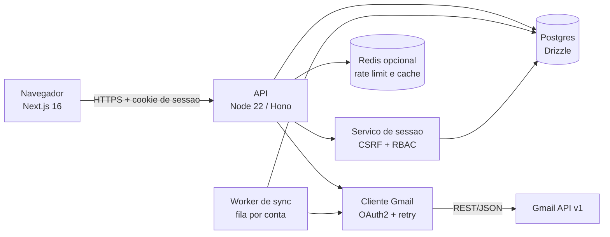

# SRS — Integração Gmail via OAuth2 (multiusuário)

- **Versão:** 1.0
- **Data:** 2026-11-15
- **Status:** planejamento — aguardando aprovação do usuário
- **Issues de referência:** [#12](https://github.com/Regimarcilio/trilhajr-app/issues/12) (planejamento) · [#13](https://github.com/Regimarcilio/trilhajr-app/issues/13) (segurança)
- **Documentos irmãos:** [`arquitetura.md`](arquitetura.md) · [`criterios-aceite.md`](criterios-aceite.md) · [`backlog-fases.md`](backlog-fases.md) · [`plano-verificacao-google-lgpd.md`](plano-verificacao-google-lgpd.md) · [`../security/threat-model-stride.md`](../security/threat-model-stride.md)
- **Substitui:** issue #4 (backend/persistência), encerrada como fora do escopo do protótipo

---

## 1. Objetivo

Evoluir o MailChat de protótipo com dados mock para um cliente de e-mail **real**, conectado a
contas Gmail de **múltiplos usuários**, com leitura de threads/mensagens/anexos e envio de
respostas — preservando a experiência de conversa já aprovada.

**Métricas de sucesso**

| ID | Métrica | Alvo |
|---|---|---|
| M-01 | Tempo entre autorizar o Google e ver a primeira lista de threads | p95 ≤ 20 s (janela de 90 dias, ≤ 500 threads) |
| M-02 | Latência das rotas de leitura (`GET /threads`, `GET /threads/:id`) | p95 ≤ 400 ms |
| M-03 | Taxa de envio bem-sucedido (excluindo rejeições do Gmail) | ≥ 99 % |
| M-04 | Sincronização incremental processando apenas novidades | ≥ 95 % das execuções sem full resync |
| M-05 | Incidentes de vazamento cruzado entre usuários | 0 (bloqueante) |
| M-06 | Custo de armazenamento por usuário ativo | ≤ 250 MB/mês no cenário de referência |

## 2. Personas e JTBD

| Persona | Descrição | JTBD |
|---|---|---|
| **Profissional ocupado** (herdada do SRS do protótipo) | Recebe dezenas de e-mails/dia com anexos e precisa decidir rápido entre responder, encaminhar ou agendar | “Quando recebo um e-mail com anexos, quero vê-lo como conversa e decidir rapidamente se respondo agora ou marco uma ação na agenda.” |
| **Usuária com múltiplas contas** | Quer separar trabalho e pessoal sem trocar de app | “Quando abro o MailChat, quero escolher qual conta Gmail estou usando e ver só as threads dela.” |
| **Administrador do deploy** (novo) | Mantém a instância no servidor próprio (porta 3100) para um grupo pequeno de usuários | “Quando um usuário pede acesso, quero provisionar a conta e auditar o que ele acessou, sem tocar em segredos no código.” |

## 3. Escopo

### 3.1 IN (esta release)

- OAuth2 Google (authorization code + PKCE S256, `state` de uso único, `access_type=offline`).
- Escopos mínimos: `openid`, `email`, `profile`, `gmail.readonly`, `gmail.send`.
- Backend multiusuário (Node 22 + TypeScript strict; Hono ou NestJS; Zod; Postgres + Drizzle).
- Persistência de usuários, contas conectadas, tokens (refresh criptografado), threads, mensagens, anexos e estado de sincronização.
- Sincronização inicial (janela configurável) e incremental (`historyId` + `users.history.list`).
- Leitura de thread/mensagem e download de anexo por API autenticada.
- Envio e resposta com threading (`In-Reply-To` / `References` / `threadId`) e anexos.
- Sessão de aplicação (cookie `HttpOnly; Secure; SameSite`) para acesso multiusuário.
- Desconexão de conta com revogação do token no Google.
- Auditoria de eventos sensíveis e painel mínimo de status de sync no frontend.
- Frontend consumindo API real em vez de `lib/api/mockApi.ts`.

### 3.2 OUT (explicitamente fora)

- Senha de app / IMAP / SMTP puro (ver ADR-001 e ADR-002).
- Provedores diferentes de Gmail (Outlook, IMAP genérico) nesta fase.
- Envio em massa, campanhas de marketing, agendamento de envio.
- Notificações push em tempo real (`users.watch` + Pub/Sub) — fase posterior.
- Aplicativo mobile nativo.
- Assinatura/criptografia ponta a ponta de e-mails.
- Funcionalidades de IA (resumo, classificação) — podem vir depois, com guardrails.
- Migração de histórico anterior a 90 dias por padrão (configurável, ver RF-GM-08).

## 4. Premissas, restrições e dependências

| ID | Premissa / Restrição | Impacto se falsa |
|---|---|---|
| P-01 | Existe um projeto no Google Cloud com a **Gmail API** habilitada e tela de consentimento configurada | Bloqueia todo o fluxo OAuth2 |
| P-02 | O app ficará em modo **Testing** durante o desenvolvimento (≤ 100 usuários de teste) | Usuários de teste precisam ser cadastrados manualmente |
| P-03 | Em Testing, o **refresh token expira em 7 dias** para apps externos | Reautenticação semanal durante o desenvolvimento |
| P-04 | Escopos `gmail.readonly` / `gmail.send` são **restritos**: uso público exige verificação e CASA | Publicação sem verificação fica limitada a test users |
| P-05 | Deploy em servidor próprio com **HTTPS** e domínio (ou subdomínio) estável | `redirect_uri` e cookies `Secure` não funcionam em HTTP |
| P-06 | Postgres disponível e com backup; Redis opcional (rate limit/fila) | Sem Redis, rate limit passa a ser em memória (aceitável em instância única) |
| P-07 | O serviço `mailchat.service` (porta 3100) permanece no ar durante o planejamento | Nenhuma ação desta fase reinicia o serviço |
| P-08 | Janela inicial de sincronização = 90 dias (configurável) | Janela maior aumenta tempo de carga e storage |
| P-09 | Quotas da Gmail API são por projeto e por usuário (ver §12.4) | Estouro gera 429/403 e degradação |
| P-10 | Não há requisito de multi-região nesta fase | Instância única + backup é suficiente |

## 5. Visão de arquitetura

Diagramas completos em [`arquitetura.md`](arquitetura.md). Resumo:



## 6. Requisitos funcionais

Prioridade MoSCoW: **M**ust, **S**hould, **C**ould, **W**on't (nesta release).

| ID | Requisito | Pri. | Aceite |
|---|---|---|---|
| RF-GM-01 | Iniciar o fluxo OAuth2 a partir da UI, criando `state` de uso único (TTL 10 min) e `code_verifier`/`code_challenge` (S256) | M | AC-GM-01 |
| RF-GM-02 | Processar o callback validando `state`, `redirect_uri` e PKCE; trocar `code` por tokens no endpoint `oauth2.googleapis.com/token` | M | AC-GM-01, AC-GM-12 |
| RF-GM-03 | Validar o `id_token` (assinatura, `iss`, `aud`, `exp`, `nonce`) e obter `sub`, `email`, `email_verified` | M | AC-GM-01 |
| RF-GM-04 | Persistir a conta conectada por usuário, com escopos concedidos e status (`pending`, `connected`, `degraded`, `revoked`, `disconnected`) | M | AC-GM-01, AC-GM-11 |
| RF-GM-05 | Armazenar o refresh token **criptografado** (AES-256-GCM, chave fora do código) e nunca devolvê-lo a nenhum cliente | M | AC-GM-01, AC-GM-10 |
| RF-GM-06 | Listar contas conectadas do usuário autenticado, com e-mail, status e `last_sync_at` | M | AC-GM-02 |
| RF-GM-07 | Executar sincronização inicial com janela configurável, paginada, com checkpoint retomável | M | AC-GM-02 |
| RF-GM-08 | Executar sincronização incremental a partir de `historyId`, aplicando apenas mudanças novas | M | AC-GM-03 |
| RF-GM-09 | Detectar `historyId` expirado (HTTP 404) e executar full resync automático, registrando o evento | M | AC-GM-13 |
| RF-GM-10 | Exibir status de sincronização na UI (`idle`, `syncing`, `degraded`, `error`) com horário da última sync | S | AC-GM-14 |
| RF-GM-11 | Listar threads escopadas por conta e usuário, ordenadas por última mensagem, com busca textual local | M | AC-GM-02, AC-GM-04 |
| RF-GM-12 | Exibir thread em estilo conversa com mensagens ordenadas, direção (entrada/saída) e separadores de data | M | AC-GM-02 |
| RF-GM-13 | Obter corpo da mensagem sob demanda (`format=full`), sanitizando HTML antes de renderizar | M | AC-GM-15 |
| RF-GM-14 | Baixar anexo por rota autenticada e escopada, com `Content-Disposition` sanitizado | M | AC-GM-05 |
| RF-GM-15 | Responder uma thread via Gmail API com `threadId`, `In-Reply-To` e `References` corretos | M | AC-GM-06 |
| RF-GM-16 | Enviar nova mensagem (sem thread existente) com destinatários, assunto, corpo e anexos | M | AC-GM-06 |
| RF-GM-17 | Suportar anexos de até 25 MB no total por mensagem, rejeitando acima disso com erro claro | M | AC-GM-16 |
| RF-GM-18 | Garantir idempotência de envio via `Idempotency-Key`, evitando duplicidade em retry | M | AC-GM-17 |
| RF-GM-19 | Registrar a mensagem enviada localmente e reconciliar com o `messageId` retornado pelo Gmail | M | AC-GM-06 |
| RF-GM-20 | Desconectar conta: revogar token no Google, apagar credenciais locais e manter dados conforme política de retenção | M | AC-GM-11 |
| RF-GM-21 | Detectar revogação externa (`invalid_grant`) sem retry infinito, marcar conta como `revoked` e orientar reconexão | M | AC-GM-11 |
| RF-GM-22 | Aplicar rate limit por usuário/conta nas rotas de sync, envio e download | M | AC-GM-18 |
| RF-GM-23 | Registrar auditoria de login, conexão, sync, leitura, download, envio, desconexão e tentativas cross-tenant | M | AC-GM-19 |
| RF-GM-24 | Persistir post-its da agenda no backend (eliminando perda ao recarregar) | S | AC-GM-20 |
| RF-GM-25 | Exportar dados do usuário (threads, mensagens e metadados) em JSON sob demanda | C | AC-GM-21 |
| RF-GM-26 | Excluir dados de uma conta desconectada após o prazo de retenção configurado | M | AC-GM-21 |

## 7. Requisitos não funcionais

| ID | Categoria | Requisito | Verificação |
|---|---|---|---|
| RNF-GM-01 | Segurança | Nenhum token, `code` ou `client_secret` em logs, respostas ou frontend | Grep de logs em teste + revisão de código |
| RNF-GM-02 | Segurança | Todo acesso a recurso valida `user_id` da sessão; IDs opacos (UUIDv7/ULID) | Testes cross-tenant automatizados |
| RNF-GM-03 | Segurança | Cookies `HttpOnly; Secure; SameSite=Lax`; CSRF em rotas de escrita | Headers inspecionados em E2E |
| RNF-GM-04 | Performance | `GET /threads` p95 ≤ 400 ms com 500 threads | k6/carga sintética |
| RNF-GM-05 | Performance | Sync inicial de 500 threads ≤ 60 s (assíncrono, com progresso) | Teste de integração cronometrado |
| RNF-GM-06 | Disponibilidade | Falha do Gmail não derruba a API; erros 5xx do provedor viram 502 com `Retry-After` | Teste com mock de falha |
| RNF-GM-07 | Resiliência | Retry com backoff exponencial + jitter para 429/5xx, máximo 5 tentativas | Teste unitário do cliente |
| RNF-GM-08 | Observabilidade | Logs estruturados JSON com `request_id`, `user_id` (hash), latência e código de erro, sem PII de corpo | Revisão de amostra de logs |
| RNF-GM-09 | Observabilidade | Métricas: syncs por status, 429/403 do Gmail, envios, falhas de token | Dashboard/endpoint `/metrics` |
| RNF-GM-10 | Privacidade | Minimização: não persistir corpo completo além do necessário à conversa; retenção configurável | Revisão de schema + política |
| RNF-GM-11 | Privacidade | Exclusão sob solicitação em ≤ 30 dias e exportação em ≤ 7 dias | Runbook + teste manual |
| RNF-GM-12 | Compatibilidade | TypeScript `strict`, sem `any` implícito; Zod em 100 % das rotas | `tsc --noEmit` + lint |
| RNF-GM-13 | Compatibilidade | Frontend continua funcionando com o contrato atual (lista, conversa, resposta, agenda) | Testes de componente existentes verdes |
| RNF-GM-14 | Acessibilidade | Estados de loading/erro e sync anunciados (`aria-live`); contraste AA mantido | Testes existentes + revisão |
| RNF-GM-15 | Operação | Configuração por variáveis de ambiente; nenhum segredo no repositório | `gitleaks` no CI |
| RNF-GM-16 | Custo | Custo de storage e quota documentado por usuário ativo | Planilha de FinOps no backlog |
| RNF-GM-17 | Manutenção | Migrations versionadas e reversíveis; seeds separados | Revisão de migrations |
| RNF-GM-18 | Conformidade | LGPD: base legal registrada, consentimento explícito, ROPA e DPO definidos | Checklist do `plano-verificacao-google-lgpd.md` |

## 8. Contratos de API

Convenções:

- Base: `https://<host>/api` (frontend usa `NEXT_PUBLIC_API_BASE_URL`).
- Autenticação: cookie de sessão `mc_session` (`HttpOnly; Secure; SameSite=Lax`).
- CSRF: header `X-CSRF-Token` obrigatório em `POST`, `PUT`, `PATCH`, `DELETE`.
- Correção: `X-Request-Id` (gerado pelo servidor se ausente), `Idempotency-Key` em envios.
- Datas em ISO 8601 UTC; IDs em UUIDv7.
- Erro padrão:

```json
{
  "error": {
    "code": "FORBIDDEN_RESOURCE",
    "message": "Recurso não encontrado.",
    "details": [],
    "requestId": "01JCV8Z3K9Q2M4T7"
  }
}
```

| Método | Rota | Auth | Descrição |
|---|---|---|---|
| GET | `/api/auth/google/start` | sessão | Cria `state` + PKCE e redireciona ao consentimento Google |
| GET | `/api/auth/google/callback` | — | Troca `code`, valida `id_token`, cria sessão e conta conectada |
| POST | `/api/auth/logout` | sessão | Invalida sessão no servidor |
| GET | `/api/me` | sessão | Usuário atual + contas conectadas |
| GET | `/api/accounts` | sessão | Lista contas do usuário |
| DELETE | `/api/accounts/:id` | sessão | Desconecta e revoga token |
| POST | `/api/accounts/:id/sync` | sessão | Dispara sync (assíncrono) |
| GET | `/api/accounts/:id/sync-status` | sessão | Estado, progresso, último erro |
| GET | `/api/threads?accountId=&cursor=&limit=` | sessão | Lista threads paginadas |
| GET | `/api/threads/:id` | sessão | Thread + mensagens (metadados) |
| GET | `/api/messages/:id` | sessão | Mensagem com corpo sanitizado |
| GET | `/api/attachments/:id` | sessão | Download streaming do anexo |
| POST | `/api/threads/:id/reply` | sessão | Responde na thread |
| POST | `/api/messages/send` | sessão | Envia nova mensagem |
| GET | `/api/postits?from=&to=` | sessão | Agenda (fase 2) |
| POST | `/api/postits` | sessão | Cria post-it (fase 2) |
| DELETE | `/api/postits/:id` | sessão | Remove post-it (fase 2) |
| GET | `/api/privacy/export` | sessão | Exportação LGPD (assíncrona) |
| DELETE | `/api/privacy/account-data` | sessão | Exclusão LGPD (assíncrona) |

### 8.1 `GET /api/auth/google/start`

Resposta `302` para `https://accounts.google.com/o/oauth2/v2/auth` com:

```
client_id, redirect_uri, response_type=code, scope=openid email profile
  https://www.googleapis.com/auth/gmail.readonly
  https://www.googleapis.com/auth/gmail.send
access_type=offline, prompt=consent, include_granted_scopes=true,
state=<opaco>, code_challenge=<S256>, code_challenge_method=S256,
login_hint=<opcional>, nonce=<opaco>
```

`state` e `code_verifier` ficam em cookie assinado de curta duração (`mc_oauth`, `HttpOnly`, TTL 600 s) — nunca em `localStorage`.

### 8.2 `GET /api/auth/google/callback?code=&state=`

- Erros: `400 OAUTH_STATE_INVALID`, `400 OAUTH_REDIRECT_MISMATCH`, `400 OAUTH_CODE_EXCHANGE_FAILED`, `401 EMAIL_NOT_VERIFIED`.
- Sucesso: `Set-Cookie: mc_session=...`, `302 /` e evento `account.connected` na auditoria.
- Sem `refresh_token` na resposta: `409 RECONSENT_REQUIRED` com instrução para refazer o fluxo com `prompt=consent`.

### 8.3 `GET /api/threads`

Query: `accountId` (obrigatório), `cursor` (opaco), `limit` (1–100, padrão 30), `q` (busca local, opcional).

```json
{
  "items": [
    {
      "id": "01JCV9A1...",
      "accountId": "01JCV8...",
      "subject": "Proposta Comercial — Projeto Aurora",
      "snippet": "Segue a proposta revisada...",
      "lastMessageAt": "2026-11-14T18:22:10Z",
      "messageCount": 3,
      "unread": true,
      "hasAttachments": true,
      "participants": [{ "name": "Ana Souza", "email": "ana@exemplo.com" }]
    }
  ],
  "nextCursor": "eyJvIjoyNX0",
  "hasMore": true
}
```

### 8.4 `GET /api/threads/:id`

```json
{
  "id": "01JCV9A1...",
  "subject": "Proposta Comercial — Projeto Aurora",
  "messages": [
    {
      "id": "01JCV9B2...",
      "direction": "inbound",
      "from": { "name": "Ana Souza", "email": "ana@exemplo.com" },
      "to": [{ "name": "Eu", "email": "eu@exemplo.com" }],
      "sentAt": "2026-11-14T18:22:10Z",
      "snippet": "Segue a proposta revisada...",
      "hasHtml": true,
      "attachments": [
        { "id": "01JCV9C3...", "filename": "Proposta_Comercial_Aurora_v2.pdf", "mimeType": "application/pdf", "sizeBytes": 248310 }
      ]
    }
  ]
}
```

### 8.5 `POST /api/threads/:id/reply`

```json
{ "bodyText": "Recebido, vou revisar hoje.", "bodyHtml": null, "attachmentIds": [] }
```

Resposta `201`:

```json
{ "messageId": "01JCV9D4...", "gmailMessageId": "18bc...", "threadId": "01JCV9A1...", "sentAt": "2026-11-15T12:01:44Z" }
```

Erros: `409 THREAD_NOT_SYNCED`, `413 ATTACHMENT_TOO_LARGE`, `429 RATE_LIMITED`, `502 GMAIL_UNAVAILABLE`.

### 8.6 `POST /api/messages/send`

```json
{
  "accountId": "01JCV8...",
  "to": ["ana@exemplo.com"],
  "cc": [],
  "bcc": [],
  "subject": "Follow-up",
  "bodyText": "...",
  "attachmentIds": []
}
```

`Idempotency-Key` obrigatório. Repetição com a mesma chave devolve a resposta original (`200`) sem reenviar.

## 9. Fluxo OAuth2 (detalhado)

1. Usuário autenticado chama `GET /api/auth/google/start`.
2. Backend gera `state` (32 bytes aleatórios, base64url) e `code_verifier` (43–128 chars); calcula `code_challenge = BASE64URL(SHA256(verifier))`; grava ambos em cookie assinado `mc_oauth` (TTL 600 s, `HttpOnly; Secure; SameSite=Lax`).
3. Redirect para o consentimento Google com escopos mínimos.
4. Usuário autoriza (ou nega → `error=access_denied`).
5. Google redireciona para `GET /api/auth/google/callback?code=&state=`.
6. Backend valida: `state` presente e igual ao cookie, cookie não expirado, `code` presente. Em falha → `400` e evento de auditoria.
7. Backend troca `code` + `code_verifier` + `client_secret` por `access_token`, `refresh_token`, `id_token` em `https://oauth2.googleapis.com/token`.
8. Backend valida `id_token` (JWKS do Google, `iss = accounts.google.com`, `aud = client_id`, `exp`, `nonce`) e exige `email_verified = true`.
9. Backend criptografa o `refresh_token` (AES-256-GCM, AAD = `account_id`, `key_version`) e persiste; o `access_token` vai para cache com TTL.
10. Cria/atualiza `connected_accounts` com `status = connected`, `scopes` concedidos e `provider_account_id = sub`.
11. Cria sessão de app (`mc_session`) com `session_id` aleatório, hash persistido, TTL absoluto 12 h e idle 2 h; define cookie.
12. Registra auditoria `account.connected` e agenda a primeira sincronização.
13. Frontend recebe `302 /` e consulta `GET /api/me`.

**Falhas mapeadas**

| Situação | HTTP | Código | Ação |
|---|---|---|---|
| `state` ausente/divergente/expirado | 400 | `OAUTH_STATE_INVALID` | Reiniciar fluxo |
| `redirect_uri` não permitida | 400 | `OAUTH_REDIRECT_MISMATCH` | Log + bloqueio |
| Usuário negou | 409 | `OAUTH_CONSENT_DENIED` | UI explica |
| Troca de code falhou | 400 | `OAUTH_CODE_EXCHANGE_FAILED` | Sem retry automático |
| Sem `refresh_token` | 409 | `RECONSENT_REQUIRED` | Refazer com `prompt=consent` |
| `email_verified = false` | 401 | `EMAIL_NOT_VERIFIED` | Bloquear conexão |

## 10. Sincronização

### 10.1 Inicial

1. Lock por conta (`sync_state.status = running`) — impede execuções concorrentes.
2. `users.getProfile` para obter `historyId` base (guardar antes de listar).
3. `users.messages.list` com `q` de janela (`newer_than:90d`) e `maxResults=100`, paginando por `nextPageToken`.
4. Para cada página: `users.messages.get` em lote (`format=metadata`, headers `Message-ID, References, In-Reply-To, Subject, From, To, Cc, Date`).
5. Agrupar por `threadId`, fazer upsert de `threads` e `messages` (idempotente por `gmail_message_id`).
6. Corpo completo (`format=full`) é buscado sob demanda na abertura da thread (RF-GM-13), reduzindo quota e storage.
7. Checkpoint por página em `sync_state.cursor_page_token`; falha permite retomar.
8. Ao final: `last_history_id = historyId`, `last_full_sync_at = now()`, `status = idle`.

### 10.2 Incremental

1. `users.history.list(startHistoryId=last_history_id)` com `historyTypes=messageAdded,messageDeleted,labelAdded,labelRemoved`.
2. Aplicar apenas mudanças; atualizar `threads` afetadas.
3. Persistir o maior `historyId` retornado.
4. `404` (history expirado/inexistente) → full resync (RF-GM-09).
5. Agenda: polling a cada 5 min por conta ativa (fase 1); `users.watch` fica para fase posterior.

### 10.3 Tratamento de erros

| Erro | Ação |
|---|---|
| `401` / `invalid_grant` | Marcar conta `revoked`; parar retries; notificar usuário (RF-GM-21) |
| `403 rateLimitExceeded` / `429` | Backoff exponencial + jitter (1s→2s→4s→8s→16s, máx. 5), respeitar `Retry-After`; `status = degraded` |
| `500`/`503` do Google | Retry com backoff; após 5 tentativas, `status = error` com `last_error_code` |
| Timeout de rede | Idem 5xx, com timeout de 15 s por chamada |
| `historyId` inválido | Full resync |

### 10.4 Quotas (referência)

- Limite por usuário: ~250 unidades de quota/segundo (por usuário do projeto).
- Limite diário por projeto: ~1 bilhão de unidades.
- Custos aproximados por chamada (conferir tabela oficial na implementação):
  `messages.list` 5 · `messages.get` 5 · `messages.attachments.get` 5 · `threads.get` 10 · `history.list` 2 · `messages.send` 100.
- Consequência de desenho: preferir `messages.list` + `messages.get` em lote, evitar `threads.get` em laço, usar `metadata` na listagem.

## 11. Envio e resposta (threading)

1. Validar payload com Zod (destinatários RFC 5322, assunto ≤ 998 bytes sem CRLF, corpo ≤ 1 MB, anexos ≤ 25 MB no total).
2. Resolver `attachmentIds` do usuário (cross-tenant check) e montar `multipart/mixed`/`multipart/alternative`.
3. Cabeçalhos:
   - `From` = endereço da conta conectada (nunca do body).
   - `To`/`Cc`/`Bcc` normalizados.
   - `Subject`: em reply, `Re: <assunto original>` (sem duplicar `Re:`).
   - `In-Reply-To` = `Message-ID` da mensagem respondida (quando existir).
   - `References` = `References` original + `Message-ID` respondida (encadeado, limite de tamanho).
   - `Date`, `Message-ID` gerados pelo servidor quando ausentes (domínio da conta).
4. Codificar MIME RFC 2822 + base64url em `raw`; chamar `users.messages.send` com `threadId` para reply.
5. Resposta do Gmail → persistir `gmail_message_id`, `thread_id`, `sent_at`; gravar mensagem local com `direction = outbound`.
6. Falha antes do envio: rollback do estado otimista. Falha ambígua (timeout): **não** reenviar automaticamente; consultar por `Idempotency-Key`/`rfc822msgid` antes de decidir.
7. Registrar auditoria `message.sent` (sem corpo).

## 12. Anexos

- Metadados vêm em `payload.parts[].body.attachmentId`; `size` e `mimeType` são confiáveis apenas como dica.
- Download via `users.messages.attachments.get` em streaming; limite de 25 MB por arquivo; rejeitar `413` acima.
- Allowlist de tipos para preview inline (`image/png`, `image/jpeg`, `application/pdf`, `text/plain`); demais forçam `attachment`.
- `Content-Disposition` com nome sanitizado (sem `/`, `\`, `..`, caracteres de controle, RTL override).
- Nunca servir anexo com `text/html` inline; sempre `attachment` + `X-Content-Type-Options: nosniff`.
- Cache opcional em storage (S3/MinIO) por `checksum`, com expiração; fase 2.

## 13. Modelo de dados (conceitual)

Detalhamento e cardinalidades em [`arquitetura.md`](arquitetura.md) (§ ER). Resumo:

| Tabela | Colunas principais | Regras |
|---|---|---|
| `users` | `id`, `email` (único), `name`, `status`, `created_at` | Identidade do app |
| `sessions` | `id`, `user_id`, `token_hash`, `expires_at`, `last_seen_at`, `revoked_at`, `ip`, `user_agent` | Nunca guardar o token em claro |
| `connected_accounts` | `id`, `user_id`, `provider`, `provider_account_id`, `email`, `scopes[]`, `status`, `connected_at`, `last_sync_at`, `last_error_code` | Único por (`user_id`, `provider_account_id`) |
| `oauth_tokens` | `account_id` (único), `refresh_ciphertext`, `refresh_iv`, `refresh_tag`, `key_version`, `access_ciphertext` (opcional), `access_expires_at` | 1:1 com conta; nunca exposto por API |
| `threads` | `id`, `user_id`, `account_id`, `gmail_thread_id`, `subject`, `snippet`, `last_message_at`, `message_count`, `unread`, `has_attachments` | Único (`account_id`, `gmail_thread_id`); índice (`user_id`, `last_message_at` desc) |
| `messages` | `id`, `user_id`, `account_id`, `thread_id`, `gmail_message_id`, `rfc_message_id`, `in_reply_to`, `references[]`, `direction`, `from_email`, `from_name`, `to_emails`, `cc_emails`, `subject`, `sent_at`, `snippet`, `body_text`, `body_html_sanitized`, `size_estimate`, `label_ids[]` | Único (`account_id`, `gmail_message_id`) |
| `attachments` | `id`, `user_id`, `account_id`, `message_id`, `gmail_attachment_id`, `filename_sanitized`, `mime_type`, `size_bytes`, `content_id`, `is_inline`, `checksum`, `storage_key` | Índice por `message_id` |
| `sync_state` | `account_id` (único), `last_history_id`, `cursor_page_token`, `last_full_sync_at`, `status`, `attempts`, `last_error_code`, `updated_at` | 1:1 com conta |
| `idempotency_keys` | `key`, `user_id`, `request_hash`, `response_json`, `created_at` | TTL 24 h |
| `audit_log` | `id`, `user_id`, `account_id`, `action`, `resource_type`, `resource_id`, `outcome`, `ip`, `user_agent`, `request_id`, `metadata`, `created_at` | Append-only |
| `postits` (fase 2) | `id`, `user_id`, `thread_id`, `title`, `date`, `time`, `color`, `created_at` | Escopado por usuário |

Regras transversais:

- Toda tabela de domínio tem `user_id NOT NULL` com FK e índice; `ON DELETE CASCADE` para dados derivados de conta; `audit_log` **não** cascateia (retenção legal).
- Migrations versionadas com Drizzle, uma por PR, sempre com `down` documentado.
- Soft delete apenas onde a política exigir (`deleted_at`), com job de expurgo.

## 14. Isolamento multi-tenant

- `userId` vem **exclusivamente** da sessão; presença de `userId`/`accountId` no body é ignorada ou rejeitada.
- Middleware `withAuth` injeta `{ userId }`; repositórios recebem `userId` como primeiro argumento obrigatório.
- Toda query de recurso inclui `WHERE user_id = $1 AND id = $2`; ausência de linha → `404` (não `403`, para não confirmar existência).
- IDs são UUIDv7; `gmail_thread_id`/`gmail_message_id` nunca são usados como identificador público de rota.
- `accountId` informado precisa pertencer ao usuário; validação explícita antes de qualquer chamada ao Gmail.
- Defesa em profundidade: RLS opcional no Postgres (`current_setting('app.user_id')`) — habilitar na fase de hardening.
- Testes cross-tenant obrigatórios em CI (thread, message, attachment, account, postit) devendo retornar 404 e gerar `audit_log` com `outcome = denied`.

## 15. Sessão e autorização

- Cookie `mc_session`: `HttpOnly; Secure; SameSite=Lax; Path=/`; em produção, prefixo `__Host-` quando o domínio permitir.
- Sessão server-side: `token_hash` (SHA-256) no banco; rotação de ID no login; TTL absoluto 12 h, idle 2 h.
- CSRF: double-submit (`mc_csrf` legível + header `X-CSRF-Token`) e checagem de `Origin`/`Referer` para rotas mutáveis.
- Logout revoga a sessão no banco e limpa cookies.
- Autorização: roles nesta fase = `user` e `admin` (admin só para operação, sem leitura de conteúdo de terceiros).
- Sem JWT em `localStorage`; sem token de provedor no frontend.

## 16. Observabilidade e auditoria

- Logs JSON: `ts`, `level`, `request_id`, `route`, `status`, `duration_ms`, `user_ref` (hash), `account_ref` (hash), `error_code`.
- Redaction obrigatória de `access_token`, `refresh_token`, `code`, `Authorization`, `Cookie`, `client_secret`.
- Métricas: contadores de sync por status, erros do Gmail por código, envios, downloads, falhas de validação.
- Auditoria (tabela `audit_log`): `auth.login`, `account.connected`, `account.disconnected`, `account.revoked`, `sync.started`, `sync.completed`, `sync.failed`, `thread.viewed`, `attachment.downloaded`, `message.sent`, `privacy.export`, `privacy.delete`, `access.denied`.
- Retenção de auditoria: 12 meses (mínimo), append-only; nunca armazenar corpo de e-mail.

## 17. LGPD (resumo operacional)

| Item | Decisão |
|---|---|
| Base legal | Execução de contrato (prestação do serviço) + consentimento explícito no fluxo OAuth |
| Finalidade | Ler, organizar e responder e-mails do próprio titular |
| Minimização | Metadados + corpo sob demanda; sem cópia integral por padrão |
| Retenção | Configurável (padrão 90 dias após desconexão, depois expurgo) |
| Exclusão | `DELETE /api/privacy/account-data` → revoga token, apaga credenciais e dados em ≤ 30 dias |
| Portabilidade | `GET /api/privacy/export` → JSON com threads/mensagens/metadados |
| Subprocessador | Google (Gmail API) — documentar no ROPA |
| Incidente | Runbook com notificação à ANPD e titulares quando aplicável |

Detalhes em [`plano-verificacao-google-lgpd.md`](plano-verificacao-google-lgpd.md).

## 18. Fases

| Fase | Conteúdo | Saída |
|---|---|---|
| F0 | Fundação: repo do backend, env, Postgres/Drizzle, healthcheck, CI | API sobe e responde `/health` |
| F1 | OAuth2 + sessão + contas conectadas | Conectar/desconectar conta com token criptografado |
| F2 | Sync read-only (threads, mensagens, anexos) | Lista e conversa reais na UI |
| F3 | Envio/reply + anexos + idempotência | Responder e enviar com threading |
| F4 | Hardening, auditoria, LGPD, verificação Google | Gate de go-live aprovado |
| F5 | Polimento (agenda persistida, busca, exportação) | Paridade com o protótipo + extras |

Backlog detalhado em [`backlog-fases.md`](backlog-fases.md).

## 19. Riscos

| ID | Risco | P | I | Mitigação |
|---|---|---|---|---|
| R-01 | Verificação Google/CASA demora e bloqueia uso público | Alta | Alto | Desenvolver em Testing com test users; planejar CASA desde a F0 |
| R-02 | Refresh token expira em 7 dias (Testing) | Alta | Médio | Reconexão assistida + aviso na UI; produção após verificação |
| R-03 | Quota da Gmail API estourada | Média | Alto | Backoff, cache, janela menor, pedido de aumento |
| R-04 | Vazamento cross-tenant (IDOR) | Baixa | Crítico | §14 + testes automatizados + RLS |
| R-05 | Vazamento de token em log/erro | Média | Crítico | Redaction + `gitleaks` + revisão |
| R-06 | Custo de storage cresce sem controle | Média | Médio | Corpo sob demanda, retenção, expurgo |
| R-07 | HTML de e-mail malicioso (XSS) | Média | Alto | Sanitização allowlist + CSP + proxy de imagens |
| R-08 | Conta comprometida usada para spam | Baixa | Alto | Rate limit por usuário, limite de destinatários, alertas |
| R-09 | Divergência entre estado local e Gmail | Média | Médio | Reconciliação por `gmail_message_id` + full resync |
| R-10 | Dependência de biblioteca MIME com bug | Baixa | Médio | Testes com fixtures reais; pinagem |

## 20. Rastreabilidade RF → épico/fase

| RF | Épico | Fase |
|---|---|---|
| RF-GM-01..05 | OAuth2 e conexão de conta | F1 |
| RF-GM-06, RF-GM-20, RF-GM-21 | Gestão de contas e revogação | F1 |
| RF-GM-07..10 | Sincronização | F2 |
| RF-GM-11..14 | Leitura de threads, mensagens e anexos | F2 |
| RF-GM-15..19 | Envio, reply e anexos | F3 |
| RF-GM-22..23 | Rate limit e auditoria | F3/F4 |
| RF-GM-24..26 | Agenda, exportação e exclusão | F5 |

Tabela completa RF → issue filha em [`backlog-fases.md`](backlog-fases.md) §4.

## 21. Limitações conhecidas (planejadas)

- Sem push em tempo real nesta release: atualização por polling de 5 min.
- Sem suporte a múltiplos provedores.
- Sem busca server-side no Gmail (busca local sobre dados sincronizados).
- Sem envio agendado, rascunhos ou templates.
- Sem anexos > 25 MB.
- UI de administração é mínima (provisionamento manual de usuários).

## 22. Definition of Done desta fase de planejamento

- [x] SRS com requisitos funcionais/não funcionais e contratos de API
- [x] Diagramas (OAuth2, sync, envio, ER, arquitetura, estados)
- [x] ADR-001 (OAuth2 vs senha de app), ADR-002 (Gmail API vs IMAP/SMTP XOAUTH2), ADR-003 (multi-tenancy e tokens)
- [x] Backlog priorizado em fases com riscos
- [x] Critérios de aceite Gherkin consolidados
- [x] Plano de verificação Google/CASA e LGPD
- [x] Issues filhas criadas e relacionadas a #12/#13 (ver comentário na issue)
