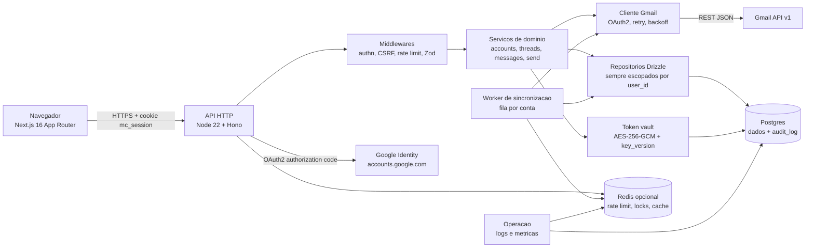
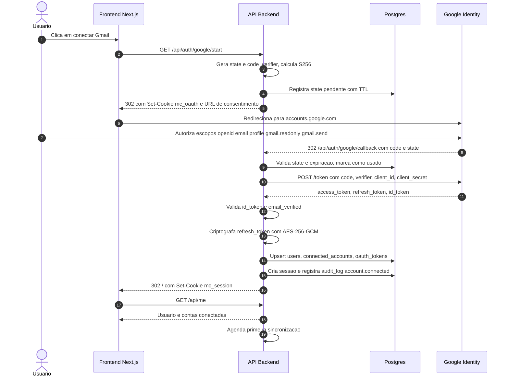
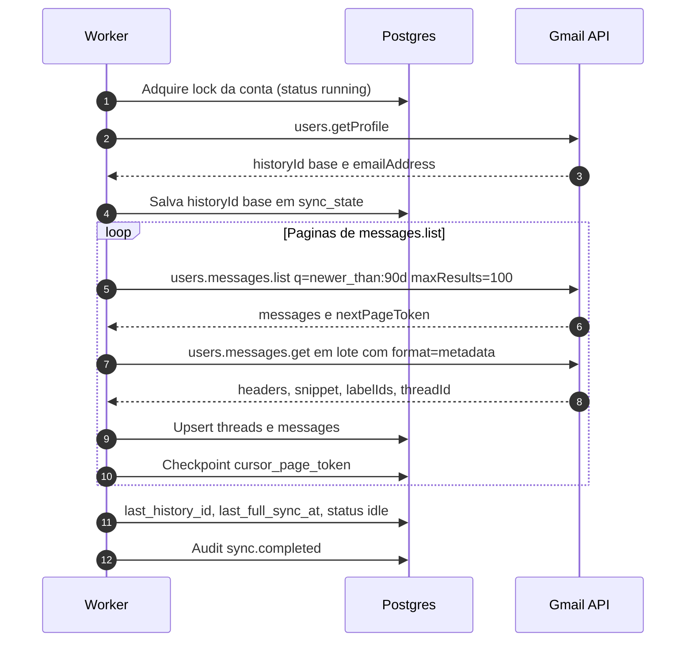
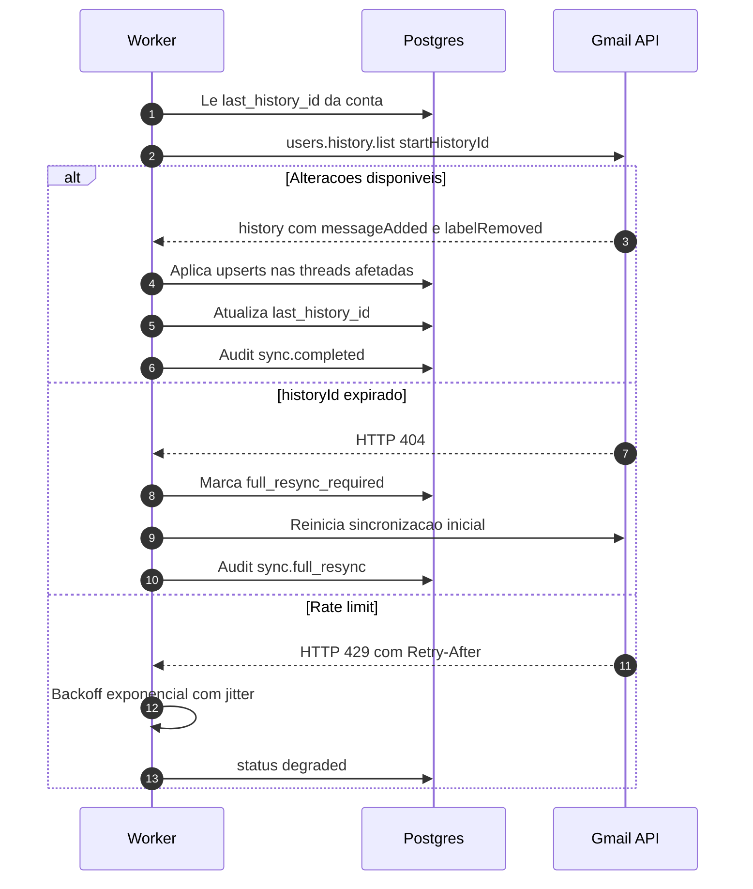
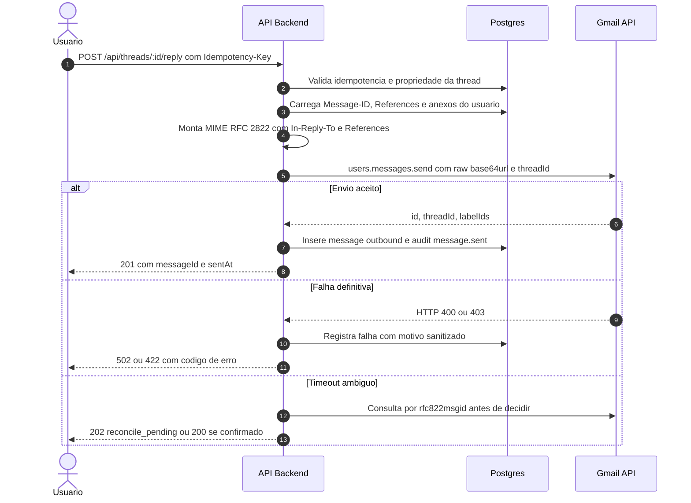
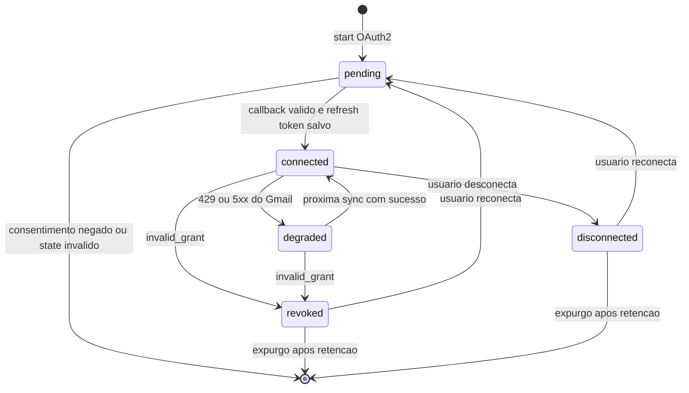
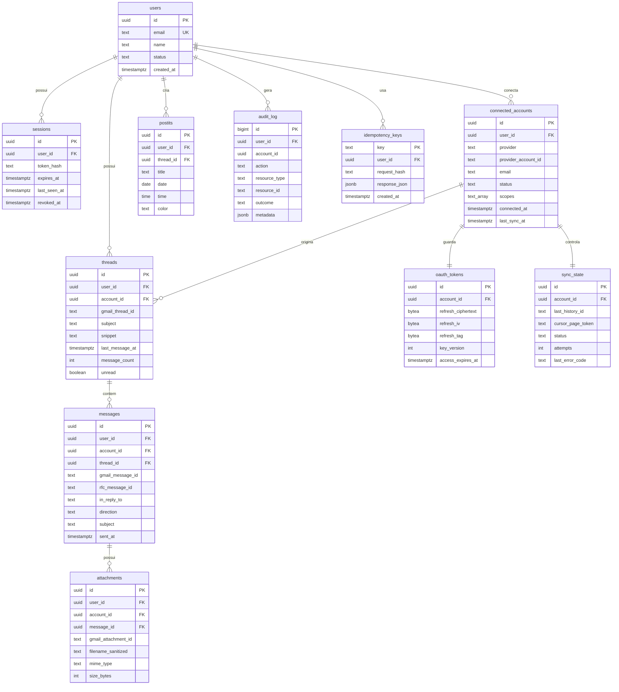
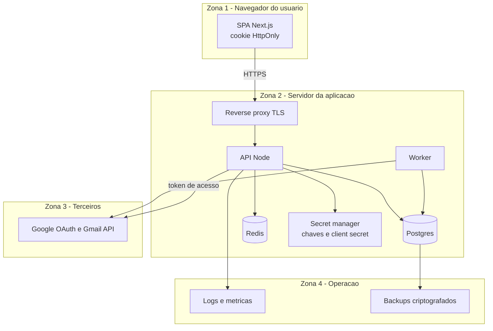

# Arquitetura — Integração Gmail OAuth2

- **Versão:** 1.0
- **Data:** 2026-11-15
- **Referências:** [SRS](SRS-gmail-oauth2.md) · [ADR-001](adr/ADR-001-oauth2-vs-senha-de-app.md) · [ADR-002](adr/ADR-002-gmail-api-vs-imap-smtp-xoauth2.md) · [ADR-003](adr/ADR-003-multitenancy-token-storage.md) · [threat model](../security/threat-model-stride.md)

## 1. Arquitetura de componentes



**Decisões de arquitetura**

1. **API separada do frontend**: o Next.js deixa de conter regra de negócio; passa a consumir `NEXT_PUBLIC_API_BASE_URL`. Permite evoluir o backend sem reescrever a UI.
2. **Worker de sincronização com fila por conta**: sync é assíncrono, com lock por `account_id`, evitando execuções concorrentes e mantendo a API responsiva.
3. **Metadados na listagem, corpo sob demanda**: reduz quota e storage; `format=metadata` na sync, `format=full` ao abrir a thread.
4. **Token vault isolado**: criptografia e rotação de chave ficam em um módulo único, auditável, com AAD por conta (ADR-003).
5. **Repositórios com `userId` obrigatório**: o isolamento multi-tenant é estrutural, não uma checagem opcional no handler.
6. **Postgres como fonte de verdade local**: o Gmail é a origem, mas a UI lê do banco; `gmail_message_id` garante idempotência.
7. **Redis opcional**: em instância única, rate limit em memória é aceitável; Redis entra quando houver múltiplas instâncias ou fila persistente.
8. **Sem JWT no cliente**: sessão opaca server-side com cookie `HttpOnly`; reduz superfície de vazamento.

## 2. Fluxo OAuth2



**Pontos de falha e resposta**

| Ponto | Falha | Resposta |
|---|---|---|
| `/start` | Sem sessão | `401 UNAUTHENTICATED` |
| Callback | `state` inválido/expirado | `400 OAUTH_STATE_INVALID`, auditoria `access.denied` |
| Callback | `error=access_denied` | `409 OAUTH_CONSENT_DENIED`, UI explica |
| `/token` | HTTP 400 `invalid_grant` | `400 OAUTH_CODE_EXCHANGE_FAILED`, sem retry |
| `/token` | Sem `refresh_token` | `409 RECONSENT_REQUIRED` |
| `id_token` | `email_verified=false` | `401 EMAIL_NOT_VERIFIED` |

## 3. Sincronização inicial



## 4. Sincronização incremental



## 5. Envio e resposta



## 6. Ciclo de vida da conexão



## 7. Modelo de dados



## 8. Fronteiras de confiança



## 9. Estrutura de pastas proposta

```
email-whatsapp/
├── backend/                      # novo (F0)
│   ├── src/
│   │   ├── app.ts                # Hono app + middlewares
│   │   ├── config/               # env validado com Zod
│   │   ├── db/                   # schema Drizzle + migrations
│   │   ├── modules/
│   │   │   ├── auth/             # OAuth2 + sessao
│   │   │   ├── accounts/
│   │   │   ├── gmail/            # cliente, retry, MIME
│   │   │   ├── threads/
│   │   │   ├── messages/
│   │   │   ├── attachments/
│   │   │   ├── sync/
│   │   │   ├── privacy/
│   │   │   └── audit/
│   │   ├── lib/                  # crypto, logger, errors
│   │   └── workers/sync.ts
│   └── tests/                    # unit + integration
├── frontend/                     # existente; troca do adapter mock
├── docs/                         # SRS, gmail/, security/, proto/
└── prototipos/                   # inalterado
```

## 10. Sequência de implementação

1. F0 — backend sobe com `/health`, env validado, schema base e CI.
2. F1 — OAuth2 + sessão + contas; teste manual de conectar/desconectar.
3. F2 — sync read-only + rotas de leitura + troca do adapter no frontend.
4. F3 — envio/reply + anexos + idempotência.
5. F4 — hardening (ver `docs/security/`), auditoria, LGPD, verificação Google.
