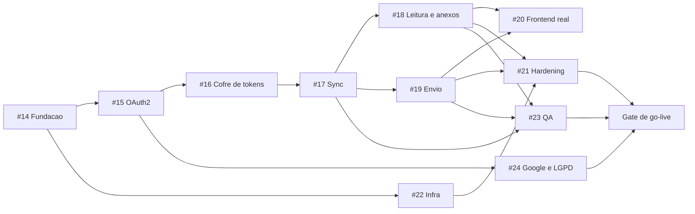

# Backlog por fases — Integração Gmail OAuth2

- **Versão:** 1.0
- **Data:** 2026-11-15
- **Issues mãe:** [#12](https://github.com/Regimarcilio/trilhajr-app/issues/12) (planejamento) · [#13](https://github.com/Regimarcilio/trilhajr-app/issues/13) (segurança)
- **Referências:** [SRS](SRS-gmail-oauth2.md) · [Arquitetura](arquitetura.md) · [Critérios de aceite](criterios-aceite.md) · [Hardening](../security/requisitos-hardening.md) · [Threat model](../security/threat-model-stride.md)

> Este backlog é o plano. As issues filhas foram abertas no GitHub e estão mapeadas na §4.
> Nenhuma implementação é iniciada sem aprovação do usuário.

## 1. Visão geral das fases

| Fase | Nome | Objetivo | Exit criteria | Esforço |
|---|---|---|---|---|
| **F0** | Fundação | Backend de pé, configuração validada, banco e CI | `/health` responde; migrations aplicam; CI verde no escopo `email-whatsapp/**` | M |
| **F1** | Identidade e conexão | OAuth2, sessão e contas conectadas com token protegido | Conectar/desconectar Gmail com refresh criptografado; nenhum token exposto | G |
| **F2** | Leitura e sincronização | Sync inicial/incremental, threads, mensagens e anexos | Lista e conversa reais na UI; incremental traz só novidades | G |
| **F3** | Envio e resposta | Reply/send com threading, anexos e idempotência | Resposta chega no Gmail e aparece na thread local, sem duplicidade | G |
| **F4** | Hardening e conformidade | Controles MUST, auditoria, LGPD, verificação Google | Gate de go-live aprovado; ST críticos verdes; laudo sem High/Critical | M |
| **F5** | Polimento | Agenda persistida, busca, exportação, UX de erro | Paridade com protótipo + extras priorizados | P |

## 2. Fase 0 — Fundação

**Objetivo:** permitir que as fases seguintes sejam incrementais e testáveis.

| Épico | Conteúdo |
|---|---|
| E0.1 Backend | Projeto `email-whatsapp/backend/` (Node 22, TypeScript strict, Hono), `/health`, tratamento de erro padronizado, `X-Request-Id` |
| E0.2 Configuração | Validação de env com Zod, `.env.example` com placeholders, falha rápida se faltar variável |
| E0.3 Dados | Drizzle + migrations iniciais (users, sessions, connected_accounts, oauth_tokens, sync_state) |
| E0.4 CI | Workflow escopado: typecheck, lint, testes, `gitleaks`, build; sem afetar outros projetos |
| E0.5 Observabilidade base | Logger JSON com redaction, endpoint de métricas mínimo |

**Exit criteria:** `GET /health` → `200 {"status":"ok"}`; `npm run db:migrate` aplica em banco limpo; CI verde.

## 3. Fases 1 a 5

### F1 — Identidade e conexão

| Épico | Conteúdo |
|---|---|
| E1.1 OAuth2 | `/auth/google/start` e `/callback`, `state` + PKCE, validação de `id_token` |
| E1.2 Sessão | Cookie `HttpOnly/Secure/SameSite`, sessão server-side, CSRF, logout |
| E1.3 Contas | `GET /accounts`, `DELETE /accounts/:id`, status e escopos |
| E1.4 Cofre de tokens | AES-256-GCM com AAD, `key_version`, rotação documentada, revogação remota |
| E1.5 Tratamento de erro | `invalid_grant` → `revoked`; sem retry infinito; aviso na UI |

**Exit criteria:** dois usuários conectam contas distintas; tokens ilegíveis no banco; desconectar revoga no Google; nenhum token em log.

### F2 — Leitura e sincronização

| Épico | Conteúdo |
|---|---|
| E2.1 Sync inicial | Janela configurável, paginação, checkpoint, lock por conta |
| E2.2 Sync incremental | `history.list` + `historyId`, full resync em 404 |
| E2.3 Resiliência | Backoff + jitter, `Retry-After`, status `degraded` |
| E2.4 Leitura | `GET /threads`, `/threads/:id`, `/messages/:id` com sanitização de HTML |
| E2.5 Anexos | Download autenticado, limite de tamanho, nome sanitizado |
| E2.6 Frontend | Adapter real para lista/conversa, estados de loading/erro/sync |

**Exit criteria:** 500 threads sincronizadas em ≤ 60 s; incremental sem full resync em ≥ 95 % das execuções; anexo baixa apenas para o dono.

### F3 — Envio e resposta

| Épico | Conteúdo |
|---|---|
| E3.1 MIME | Montagem RFC 2822, `raw` base64url, validação de CRLF |
| E3.2 Threading | `In-Reply-To`, `References`, `threadId`, assunto com `Re:` sem duplicar |
| E3.3 Anexos no envio | `multipart/mixed`, limite 25 MB, erro 413 claro |
| E3.4 Idempotência | `Idempotency-Key`, consulta antes de reenviar em timeout |
| E3.5 Reconciliação | Persistir `gmail_message_id`, atualizar thread, tratar falha ambígua |

**Exit criteria:** resposta enviada aparece no Gmail e na thread local; retry com a mesma chave não duplica; falha 4xx do Gmail vira erro claro ao usuário.

### F4 — Hardening e conformidade

| Épico | Conteúdo |
|---|---|
| E4.1 Controles MUST | Implementar `SR-xx` marcados como MUST (ver `docs/security/requisitos-hardening.md`) |
| E4.2 Isolamento | Testes cross-tenant, RLS opcional, revisão de repositórios |
| E4.3 Rate limit | Por IP/usuário/conta em sync, envio, download e auth |
| E4.4 Auditoria | `audit_log` append-only, eventos definidos no SRS §16 |
| E4.5 LGPD | Exportação, exclusão, retenção, ROPA, runbook de incidente |
| E4.6 Verificação Google | Consent screen, domínio, CASA, pedido de quota |

**Exit criteria:** checklist de deploy completo; laudo sem Critical/High; ST críticos verdes; verificação Google submetida ou aprovada.

### F5 — Polimento

- Persistir post-its (`postits`), busca local, exportação JSON, UX de reconexão, estados vazios.
- Acessibilidade dos novos estados; revisão de performance.

## 4. Issues filhas (mapeamento)

| ID | Issue | Título | Labels | Fase | Depende de |
|---|---|---|---|---|---|
| #14 | [#14](https://github.com/Regimarcilio/trilhajr-app/issues/14) | feat(backend): fundação do backend MailChat (Hono, env Zod, Drizzle, healthcheck) | feat, data, sev:high | F0 | — |
| #15 | [#15](https://github.com/Regimarcilio/trilhajr-app/issues/15) | feat(auth): OAuth2 Google com PKCE, sessão HttpOnly e contas conectadas | feat, sec, sev:high | F1 | #14 |
| #16 | [#16](https://github.com/Regimarcilio/trilhajr-app/issues/16) | feat(sec): cofre de tokens criptografado, rotação e revogação de conta | feat, sec, sev:high | F1 | #15 |
| #17 | [#17](https://github.com/Regimarcilio/trilhajr-app/issues/17) | feat(backend): sincronização inicial e incremental do Gmail (historyId) | feat, sev:high | F2 | #16 |
| #18 | [#18](https://github.com/Regimarcilio/trilhajr-app/issues/18) | feat(backend): leitura de threads/mensagens e download seguro de anexos | feat, sec, sev:high | F2 | #17 |
| #19 | [#19](https://github.com/Regimarcilio/trilhajr-app/issues/19) | feat(backend): envio e resposta com threading, anexos e idempotência | feat, sev:high | F3 | #17 |
| #20 | [#20](https://github.com/Regimarcilio/trilhajr-app/issues/20) | feat(frontend): substituir adapter mock por API real (contas, sync, anexos, erros) | feat, sev:high | F2/F3 | #18 |
| #21 | [#21](https://github.com/Regimarcilio/trilhajr-app/issues/21) | sec(backend): hardening multi-tenant, rate limit, auditoria e sanitização | sec, sev:high | F4 | #15..#20 |
| #22 | [#22](https://github.com/Regimarcilio/trilhajr-app/issues/22) | infra(mailchat): deploy multiusuário com TLS, secrets, backup e observabilidade | infra, ops, sev:high | F0/F4 | #14 |
| #23 | [#23](https://github.com/Regimarcilio/trilhajr-app/issues/23) | test(mailchat): QA de integração Gmail, cross-tenant e E2E de sync/envio | test, qa, sev:high | F2–F4 | #17..#20 |
| #24 | [#24](https://github.com/Regimarcilio/trilhajr-app/issues/24) | docs(mailchat): verificação Google/CASA e conformidade LGPD | docs, plan, sev:medium | F4 | #15 |

## 5. Ordem de execução recomendada

```
F0:  #14  →  #22 (paralelo, apenas preparação de deploy)
F1:  #15  →  #16
F2:  #17  →  #18  →  #20 (parcial: lista e conversa)
F3:  #19  →  #20 (completo: envio e anexos)
F4:  #21  →  #23  →  #24  →  gate de go-live
F5:  polimento (novas issues sob demanda)
```

## 6. Matriz de dependências



## 7. Riscos por fase

| Fase | Risco | Mitigação |
|---|---|---|
| F0 | Escopo do CI afetar outros projetos | Filtro `paths: email-whatsapp/**` já existente; revisar antes do merge |
| F1 | Refresh token expirando em 7 dias (Testing) | Aviso na UI + reconexão assistida; documentar para test users |
| F2 | Quota estourada no sync inicial | Janela 90 dias, `metadata`, backoff, sync sob demanda |
| F2 | Divergência de dados | Idempotência por `gmail_message_id`, full resync |
| F3 | Erro de MIME/threading | Fixtures reais, testes de integração, validação de CRLF |
| F3 | Envio duplicado em timeout | `Idempotency-Key` + consulta por `rfc822msgid` |
| F4 | Verificação Google/CASA demora | Iniciar cedo (#24), manter Testing para o grupo piloto |
| F4 | Vazamento cross-tenant | Testes automatizados + RLS + revisão de código |
| F5 | Scope creep | Priorizar por valor; novas issues com AC |

## 8. Estimativas e capacidade

- P (pequeno): ≤ 2 dias · M (médio): 3–5 dias · G (grande): 6–10 dias.
- F0: M · F1: G · F2: G · F3: G · F4: M · F5: P.
- Total estimado: **~5 a 7 semanas** de um desenvolvedor full-stack, condicionado à verificação
  Google (que corre em paralelo e pode somar semanas de espera externa).

## 9. Definição de pronto (todas as issues)

- Critérios de aceite Gherkin da issue cumpridos.
- Testes automatizados verdes (unitários + integração; E2E quando aplicável).
- `npm audit`/`osv-scanner` sem High/Critical e `gitleaks` limpo.
- Sem Critical/High no laudo KALIMASTER.
- Documentação atualizada (`docs/gmail/`, `docs/security/`, `docs/dev-log.md`).
- PR em Conventional Commits, revisado, com `Closes #n`, sem merge sem aprovação do usuário.
