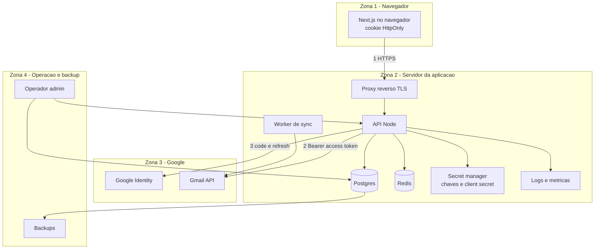

# Threat Model (STRIDE) — MailChat + Gmail OAuth2

- **Versão:** 1.0
- **Data:** 2026-11-15
- **Autor:** KALIMASTER (squad)
- **Issues:** [#13](https://github.com/Regimarcilio/trilhajr-app/issues/13) (segurança) · [#12](https://github.com/Regimarcilio/trilhajr-app/issues/12) (planejamento)
- **Documentos irmãos:** [Requisitos de hardening](requisitos-hardening.md) · [Plano de testes de segurança](plano-testes-seguranca.md) · [Checklist de deploy](checklist-deploy.md) · [Laudo inicial](laudo-inicial.md) · [SRS](../gmail/SRS-gmail-oauth2.md)

> Este documento antecede a implementação. Nenhum controle aqui descrito está aplicado no
> protótipo atual (dados mock, sem autenticação). O objetivo é evitar retrabalho e decisões
> inseguras na fase de construção.

## 1. Metodologia e escopo

- **Metodologia:** STRIDE por componente e por fluxo, com fronteiras de confiança explícitas,
  inventário de ativos e matriz probabilidade × impacto.
- **Escopo:** fluxo OAuth2, sessão do app, sincronização inicial/incremental, leitura de
  thread/mensagem, download de anexo, envio/resposta, desconexão/revogação, operação/administração.
- **Fora de escopo:** comprometimento da infraestrutura do Google; dispositivo do usuário
  comprometido por malware com acesso ao navegador; pentest externo contratado (fase posterior);
  engenharia social presencial.
- **Premissas:** deploy em servidor próprio com TLS; Postgres com backup; um único tenant lógico
  (instância) com múltiplos usuários; sem IA nesta fase.

## 2. Fronteiras de confiança

Fronteiras numeradas: (1) navegador → servidor; (2) servidor → Gmail; (3) servidor → Google
Identity; (4) operador → servidor/banco. Cada travessia exige autenticação, autorização e
validação de dados.

## 3. Inventário de ativos

| ID | Ativo | Sensibilidade | Onde vive |
|---|---|---|---|
| A-01 | `refresh_token` | Crítica | Postgres (cifrado) |
| A-02 | `access_token` | Alta | Redis/memória (TTL curto) |
| A-03 | `id_token` / identidade Google | Média | Memória durante o callback |
| A-04 | `client_secret` | Crítica | Secret manager |
| A-05 | Chave mestra de criptografia (KEK/DEK) | Crítica | Secret manager |
| A-06 | Conteúdo de e-mails e anexos | Crítica | Postgres / storage opcional |
| A-07 | PII de usuários (nome, e-mail) | Alta | Postgres |
| A-08 | Sessões do app | Alta | Postgres (hash) + cookie |
| A-09 | Logs e métricas | Média | Coletor de logs |
| A-10 | Backups | Crítica | Storage de backup |
| A-11 | Auditoria | Alta | Postgres (append-only) |
| A-12 | Código e dependências | Média | Repositório / runner de CI |

## 4. Modelagem de atacantes

| ID | Atacante | Capacidade | Motivação |
|---|---|---|---|
| AT-01 | Externo não autenticado | Internet, scanning, força bruta | Acesso a dados, spam |
| AT-02 | Usuário autenticado curioso/malicioso | Sessão válida, conhece IDs | Ler caixa de outro usuário (IDOR) |
| AT-03 | Operador com acesso ao servidor | Shell, env, banco | Ler conteúdo, exfiltrar tokens |
| AT-04 | Atacante com acesso a logs/backups | Leitura de artefatos | Encontrar tokens/PII |
| AT-05 | Dependência comprometida | Execução no processo | Roubar secrets em runtime |
| AT-06 | Conta de e-mail comprometida | Credenciais do provedor | Usar o app para spam/phishing |
| AT-07 | Atacante de rede (MITM) | Posição de rede | Interceptar OAuth/cookies |

## 5. Tabela STRIDE

Legenda: P = probabilidade (Baixa/Média/Alta), I = impacto (Baixo/Médio/Alto/Crítico).
Risco inerente antes dos controles. Controles referenciam `SR-xx` em
[`requisitos-hardening.md`](requisitos-hardening.md).

### 5.1 Spoofing

| ID | Componente | Cenário | Ativo | P | I | Risco | Controles | Residual |
|---|---|---|---|---|---|---|---|---|
| T-01 | Sessão do app | Atacante rouba cookie de sessão e se passa pelo usuário | A-08, A-06 | Média | Alto | Alto | SR-15, SR-16, SR-17, SR-19 | Baixo |
| T-02 | OAuth consent | App falso ou nome enganoso induz o usuário a autorizar | A-01 | Média | Alto | Alto | SR-20, verificação Google | Médio |
| T-03 | Envio | `From` manipulado no corpo da requisição para enviar em nome de outro endereço | A-06 | Média | Médio | Médio | SR-27 | Baixo |
| T-04 | Callback OAuth | `state` fixado/reutilizado para vincular a conta do atacante à sessão da vítima | A-01, A-08 | Baixa | Alto | Alto | SR-01, SR-02, SR-05 | Baixo |

### 5.2 Tampering

| ID | Componente | Cenário | Ativo | P | I | Risco | Controles | Residual |
|---|---|---|---|---|---|---|---|---|
| T-05 | Callback OAuth | `redirect_uri` manipulada para desviar o `code` | A-01, A-03 | Média | Alto | Alto | SR-03, allowlist exata | Baixo |
| T-06 | Envio MIME | Injeção de CRLF em assunto/destinatário cria headers extras (BCC oculto) | A-06 | Média | Alto | Alto | SR-26, SR-27 | Baixo |
| T-07 | API de escrita | Cliente envia `userId`/`accountId` de terceiro no body | A-06 | Média | Crítico | Crítico | SR-21, SR-22 | Baixo |
| T-08 | Anexos | Nome com `../` ou caracteres de controle grava/expõe arquivo indevido | A-06 | Média | Alto | Alto | SR-31 | Baixo |
| T-09 | Estado local | Divergência entre banco e Gmail permite alterar histórico exibido | A-06 | Baixa | Médio | Médio | SR-28, reconciliação | Baixo |

### 5.3 Repudiation

| ID | Componente | Cenário | Ativo | P | I | Risco | Controles | Residual |
|---|---|---|---|---|---|---|---|---|
| T-10 | Auditoria | Usuário nega ter enviado/baixado conteúdo e não há prova | A-11 | Média | Médio | Médio | SR-34, SR-35 | Baixo |
| T-11 | Logs | Operador altera/apaga logs para encobrir acesso | A-09, A-11 | Baixa | Alto | Médio | SR-33, SR-35, retenção imutável | Médio |

### 5.4 Information disclosure

| ID | Componente | Cenário | Ativo | P | I | Risco | Controles | Residual |
|---|---|---|---|---|---|---|---|---|
| T-12 | Logs/erros | Token, `code` ou cookie aparece em log, stack trace ou URL | A-01, A-02, A-04 | Média | Crítico | Crítico | SR-13, SR-32, SR-33 | Baixo |
| T-13 | API de leitura | IDOR: usuário A acessa thread/anexo de B por ID | A-06 | Média | Crítico | Crítico | SR-21..SR-24, testes cross-tenant | Baixo |
| T-14 | Backups | Dump do banco sem criptografia expõe tokens e conteúdo | A-01, A-06, A-10 | Média | Crítico | Alto | SR-09, SR-10, SR-38 | Baixo |
| T-15 | Renderização | HTML de e-mail com script/XSS rouba sessão ou exfiltra dados | A-06, A-08 | Média | Alto | Alto | SR-29, SR-30, CSP | Baixo |
| T-16 | Imagens remotas | Tracking pixel revela IP, horário de abertura e agente | A-06, A-07 | Alta | Baixo | Médio | SR-30 (proxy/bloqueio) | Baixo |
| T-17 | Download | Anexo servido por URL previsível e sem auth | A-06 | Média | Alto | Alto | SR-23, SR-24, SR-31 | Baixo |
| T-18 | Enumeração | Respostas diferenciadas revelam existência de contas/IDs | A-07 | Média | Médio | Médio | SR-23 (404 uniforme), rate limit | Baixo |
| T-19 | Exportação LGPD | Exportação enviada ao usuário errado | A-06, A-07 | Baixa | Alto | Médio | SR-21, confirmação e auditoria | Baixo |

### 5.5 Denial of service

| ID | Componente | Cenário | Ativo | P | I | Risco | Controles | Residual |
|---|---|---|---|---|---|---|---|---|
| T-20 | Sync | Loop de full resync consome quota e derruba o serviço | A-06 | Média | Alto | Alto | SR-28, SR-36, circuit breaker | Baixo |
| T-21 | Auth | Força bruta em callback/login sem limite | A-08 | Média | Médio | Médio | SR-36, SR-37 | Baixo |
| T-22 | Anexos | Arquivo enorme ou zip bomb esgota memória/disco | A-06 | Média | Médio | Médio | SR-25, SR-31, streaming | Baixo |
| T-23 | API | Requisições massivas de listagem degradam a instância | A-06 | Média | Médio | Médio | SR-36, paginação obrigatória | Baixo |

### 5.6 Elevation of privilege

| ID | Componente | Cenário | Ativo | P | I | Risco | Controles | Residual |
|---|---|---|---|---|---|---|---|---|
| T-24 | Admin | Operador usa papel admin para ler conteúdo de usuários | A-06 | Média | Crítico | Alto | SR-24, separação de papéis, auditoria | Médio |
| T-25 | Proxy de imagem | SSRF via URL de imagem de e-mail acessa rede interna | A-06 | Baixa | Alto | Médio | SR-30 allowlist de esquema/host, bloqueio de IP privado | Baixo |
| T-26 | Token roubado | Refresh token exfiltrado dá acesso persistente à caixa | A-01 | Baixa | Crítico | Alto | SR-07, SR-08, SR-09, detecção de anomalia | Médio |
| T-27 | Supply chain | Dependência maliciosa lê env e exfiltra secrets | A-04, A-05 | Média | Crítico | Alto | SR-39, SR-40, lockfile, revisão | Médio |
| T-28 | CSRF | Site externo dispara envio/desconexão em nome do usuário | A-06, A-08 | Média | Médio | Médio | SR-18, SR-19 | Baixo |

## 6. Análise específica por fluxo

### 6.1 OAuth2 start/callback
- `state` previsível ou sem vínculo com o navegador → CSRF de login (conta do atacante vinculada à vítima). Mitigação: `state` aleatório de 32 bytes, uso único, TTL 10 min, cookie assinado `HttpOnly`.
- `code` interceptado por `redirect_uri` permissiva. Mitigação: allowlist exata, PKCE S256, sem wildcard.
- `id_token` não validado permite identidade forjada. Mitigação: validar assinatura via JWKS, `iss`, `aud`, `exp`, `nonce`, `email_verified`.
- Replay de `code`: o Google invalida após uso, mas o backend deve rejeitar callback duplicado.

### 6.2 Sessão do app
- Cookie sem `HttpOnly` → XSS rouba sessão. Cookie sem `Secure` → MITM. Sem `SameSite` → CSRF.
- Fixation: rotacionar ID de sessão no login.
- Logout apenas no cliente não invalida a sessão no servidor.

### 6.3 Sincronização
- Sync concorrente na mesma conta gera duplicatas e estouro de quota. Mitigação: lock por conta.
- `historyId` expirado sem tratamento → loop. Mitigação: detectar 404 e full resync com limite.
- Conteúdo sincronizado de outra conta por bug de escopo → mitigação estrutural (§ADR-003) + testes.

### 6.4 Leitura e anexos
- `gmail_thread_id` exposto em rota permite enumeração e tentativa de bypass. Mitigação: UUID interno.
- Anexo `text/html` servido inline → XSS no domínio do app. Mitigação: sempre `attachment` + `nosniff`.
- Corpo HTML sem sanitização → XSS armazenado. Mitigação: allowlist (sem `script`, `iframe`, `on*`, `javascript:`), CSP, proxy de imagens.

### 6.5 Envio
- MIME malformado pode gerar cópia oculta (BCC injetado). Mitigação: validação estrita e geração server-side.
- Reenvio em timeout duplica mensagens. Mitigação: `Idempotency-Key` + consulta por `rfc822msgid`.
- Conta comprometida usada para spam: rate limit por usuário e limite de destinatários, com alerta.

### 6.6 Desconexão/revogação
- Revogar apenas localmente deixa o token válido no Google. Mitigação: chamar endpoint de revogação.
- `invalid_grant` tratado como erro transitório gera retry infinito. Mitigação: classificar como permanente.

### 6.7 Operação e administração
- Operador com acesso ao banco pode ler conteúdo. Mitigação: criptografia de tokens, minimização de corpo, auditoria de acesso, princípio de menor privilégio, separação de funções.
- Backups sem criptografia são o maior risco de vazamento em massa. Mitigação: criptografia + chave separada + expiração.

## 7. Top 10 riscos priorizados

| # | ID | Risco | Severidade | Justificativa |
|---|---|---|---|---|
| 1 | T-13 | IDOR/cross-tenant | Crítico | Vazamento direto de caixa alheia; quebra de confiança e LGPD |
| 2 | T-12 | Token em log/erro | Crítico | Um único log exposto compromete contas permanentemente |
| 3 | T-07 | `userId` vindo do cliente | Crítico | Bypass trivial de isolamento |
| 4 | T-26 | Refresh token exfiltrado | Alto | Acesso persistente mesmo após troca de senha |
| 5 | T-14 | Backup sem criptografia | Alto | Exposição em massa de tokens e conteúdo |
| 6 | T-15 | XSS via HTML de e-mail | Alto | Roubo de sessão e ações em nome do usuário |
| 7 | T-27 | Supply chain | Alto | Compromete todos os segredos de uma vez |
| 8 | T-05 | `redirect_uri` manipulada | Alto | Interceptação de `code` |
| 9 | T-17 | Anexo sem autorização | Alto | Exfiltração de documentos |
| 10 | T-20 | Loop de sync / quota | Alto | Indisponibilidade e custo |

## 8. Premissas e limitações

- O threat model assume TLS válido e servidor sem comprometimento prévio.
- Não cobre abuso de funcionalidades futuras (IA, múltiplos provedores); deverá ser revisado.
- Não substitui pentest externo nem CASA.
- A revisão deve ocorrer a cada fase (F1, F3, F4) e a cada nova superfície exposta.
- IA (resumo/classificação) exigirá análise de prompt injection e vazamento de contexto antes de
  entrar em produção.
