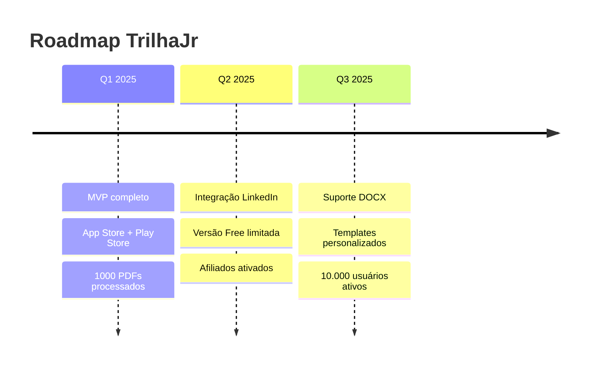

# 🚀 TrilhaJr - O Caminho para o Seu Emprego Perfeito

> **App mobile inteligente que transforma seu currículo em destaque no ATS (Applicant Tracking System)**

[](https://expo.dev/)
[](LICENSE)
[](https://www.typescriptlang.org/)

---

## 🎯 O Problema

> **75% dos currículos brasileiros são rejeitados por ATS mal formatados**

Empresas usam sistemas automatizados para filtrar candidatos, e currículos mal estruturados são automaticamente descartados antes mesmo de serem lidos por uma pessoa.

---

## ✨ TrilhaJr - Solução

O TrilhaJr é um **app mobile** que:

1. 📲 **Carrega seu PDF** em 3 segundos
2. 💰 **Paga via Pix** (sem cadastro!) - R$ 4,90
3. 🤖 **Processa com IA** para otimização ATS
4. 📥 **Recebe PDF pronto** - compartilhável direto

---

## 🎨 Design System

### Paleta de Cores
```css
--trilhajr-primary: #1E3A8A;    /* Azul profundo - confiança */
--trilhajr-secondary: #F3F4F6;     /* Cinza claro - profissionalismo */
--trilhajr-accent: #3B82F6;        /* Azul vibrante - ação */
--trilhajr-gradient: linear-gradient(135deg, #1E3A8A 0%, #3B82F6 100%);
--trilhajr-success: #10B981;       /* Verde - concluído */
--trilhajr-warning: #F59E0B;       /* Amarelo - atenção */
```

### Tipografia
- **Fonte principal:** Inter - moderna e legível
- **Tamanhos:** 14px base, escala 1.25
- **Peso:** 400 (regular), 600 (semibold), 700 (bold)

### Ícones e Símbolos
- **🧭 Trilha:** Navegação e progresso
- **📄 PDF:** Documentos e currículo
- **✅ Check:** Conclusão e aprovação
- **🔍 Lupa:** Busca e otimização

---

## 📱 Protótipo Disponível

**Protótipo navegável:** [Ver protótipo online](design-system/prototipo.html)

### Fluxo do Usuário
```
1. [Boas-vindas] → Conheça o TrilhaJr
2. [Carregar PDF] → Upload do currículo
3. [Pagar Pix] → QR Code sem cadastro
4. [Resultado] → PDF otimizado e pronto
```

---

## 🛠️ Tecnologias

### Frontend Mobile
- **React Native** + Expo - Desenvolvimento rápido
- **TypeScript** - Segurança de tipos
- **Zustand** - Estado leve
- **React Hook Form** - Validação de formulários

### Backend
- **Node.js** + Express - API leve
- **TypeScript** - Código limpo
- **Asaas SDK** - Pagamento Pix
- **pdf-lib** - Manipulação PDF

### IA/ML
- **Python** + FastAPI
- **spaCy** - Processamento de texto
- **pdfplumber** - Extração de conteúdo

### Infraestrutura
- **Docker** - Containerização
- **PostgreSQL** - Banco de dados (opcional)
- **Redis** - Cache e sessões

---

## 📁 Estrutura do Projeto

```
trilhajr-app/
├── mobile-app/              # Frontend React Native
│   ├── src/
│   │   ├── screens/        # Tela: Welcome, Upload, Payment, Result
│   │   ├── components/     # Componentes UI reutilizáveis
│   │   ├── services/       # APIs e integrações
│   │   └── utils/          # Helpers
│   └── package.json
│
├── backend-api/             # API Node.js
│   ├── src/
│   │   ├── controllers/    # Lógica de negócios
│   │   ├── routes/         # Definição de rotas
│   │   ├── services/       # PDF, Pix, AI
│   │   └── middleware/     # Auth, uploads, erros
│   └── package.json
│
├── ai-service/              # Microserviço IA
│   ├── main.py             # FastAPI server
│   ├── services/           # Processamento ATS
│   └── requirements.txt
│
├── docs/                   # Documentação completa
│   ├── SRS.md              # Software Requirements
│   ├── 01-arquitetura.md   # Arquitetura do sistema
│   ├── 02-pagamento-pix.md # Integração Pix
│   ├── 03-processamento-pdf.md # Otimização PDF
│   ├── 04-prototipacao.md  # Prototipação
│   ├── 05-backlog.md       # Backlog Scrum
│   └── 06-plano-de-entrega.md # Plano 12 semanas
│
├── design-system/          # Design e protótipos
│   └── prototipo.html      # Protótipo navegável
│
├── infra/                  # Docker, CI/CD
│   ├── docker-compose.yml
│   ├── Dockerfile.api
│   └── Dockerfile.ia
│
└── README.md               # Este arquivo
```

---

## 🚀 Setup Local

### Pré-requisitos
- Node.js 18+ 
- npm 9+
- Python 3.11+
- Docker + Docker Compose

### Instalação

```bash
# 1. Clonar repositório
git clone https://github.com/seu-usuario/trilhajr-app.git
cd trilhajr-app

# 2. Instalar dependências
npm ci

# 3. Setup mobile
cd mobile-app
npm install
npx expo start

# 4. Setup backend
cd ../backend-api
npm install
npm run dev

# 5. Setup IA
cd ../ai-service
pip install -r requirements.txt
python main.py

# 6. Ou com Docker (tudo junto)
cd ../infra
docker-compose up -d
```

---

## 💳 Fluxo de Pagamento

**Sem cadastro, sem login, sem complicação:**
1. Usuário carrega PDF
2. App gera QR Code Pix (R$ 4,90)
3. Usuário paga com app do bank
4. Webhook confirma pagamento
5. PDF otimizado disponibilizado

---

## 📊 Métricas de Sucesso

| Métrica | Meta | Atual |
|---------|------|-------|
| Conversão Pix → PDF | > 85% | - |
| Tempo processamento | < 10s | - |
| Taxa de compartilhamento | > 70% | - |
| CAC (custo aquisição) | < R$ 15 | - |

---

## 🏗️ Roadmap



---

## 🤝 Contribuição

1. Fork o projeto
2. Crie feature branch (`git checkout -b feature/nova-funcionalidade`)
3. Commit (`git commit -m 'feat: nova funcionalidade'`)
4. Push (`git push origin feature/nova-funcionalidade`)
5. Abra Pull Request

---

## 📄 Licença

Este projeto está licenciado sob MIT - veja o arquivo [LICENSE](LICENSE) para mais detalhes.

---

## ✉️ Contato

**Equipe TrilhaJr**
- Email: contato@trilhajr.app
- Twitter: @trilhajr_app
- LinkedIn: TrilhaJr App

---

> "Seu currículo merece ser o primeiro a aparecer na lista de candidatos. Deixe-nos ajudar a construir essa trilha."

**`Developed with ❤️ by TrilhaJr Team`**